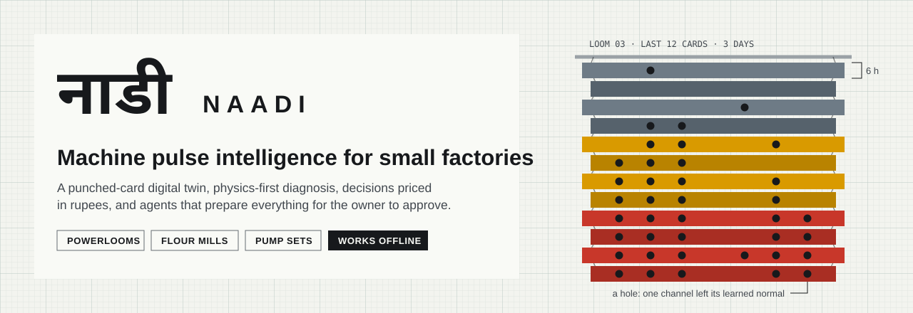
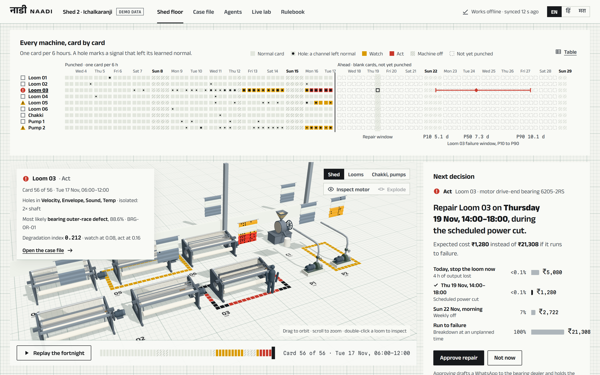
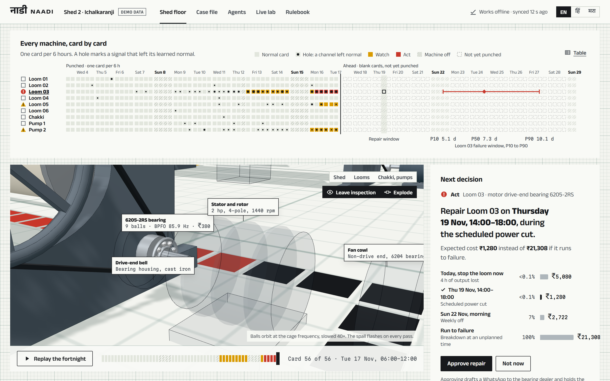
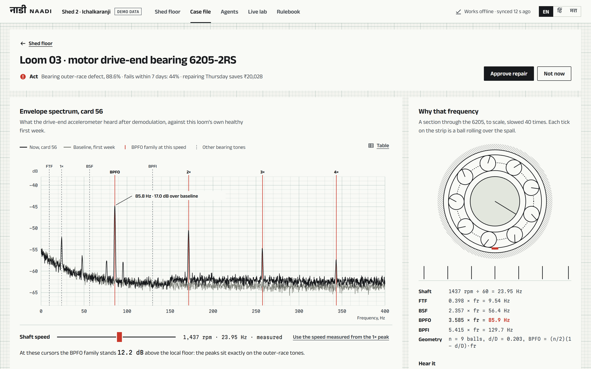
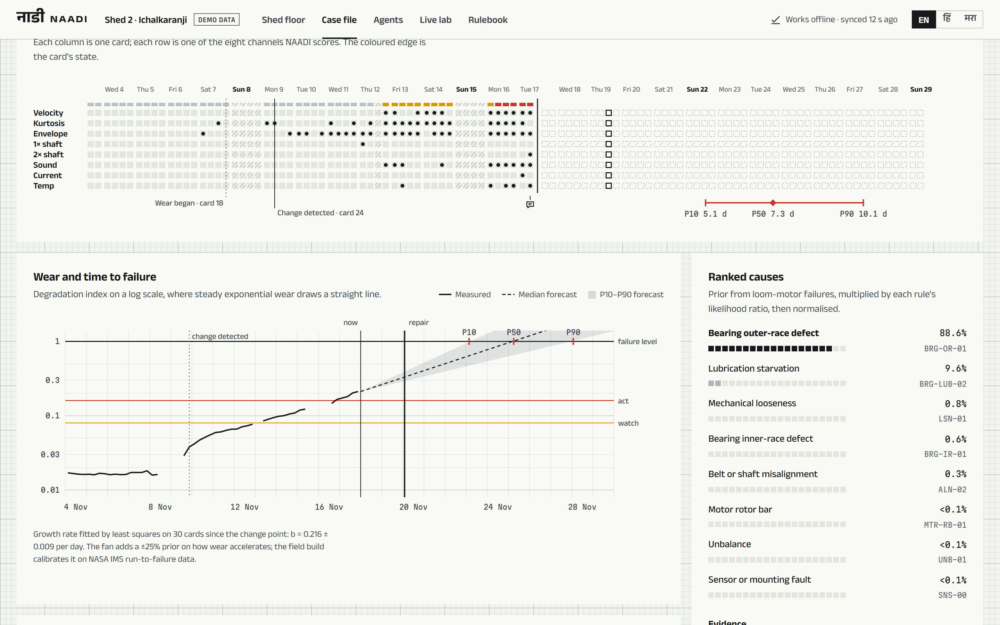
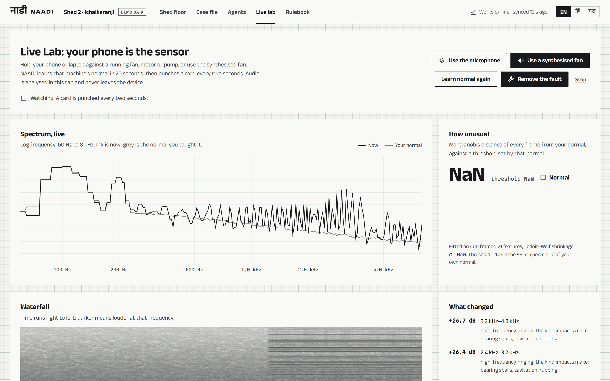
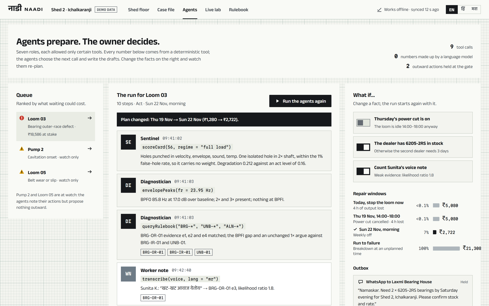
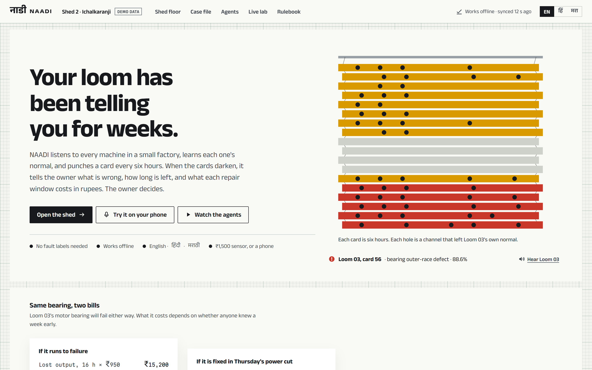
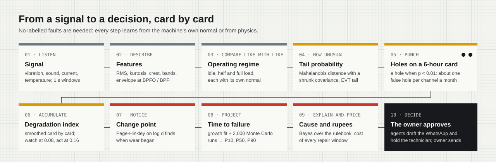
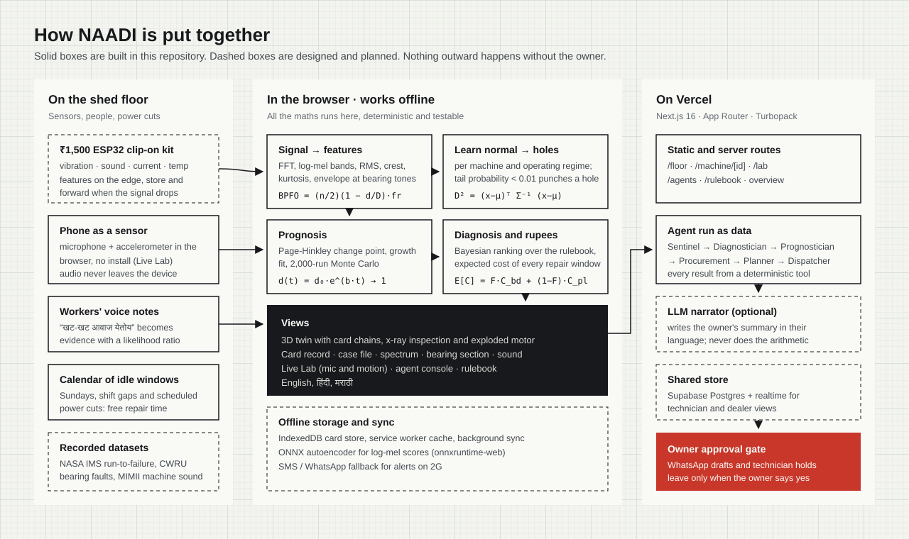

<p align="center">
  
</p>

<p align="center">
  <b>नाडी · NAADI</b> reads a machine's pulse the way a mill owner already does, by sound and feel,<br>
  and turns it into physics, a time to failure, a decision priced in rupees, and a repair the owner approves.
</p>

<p align="center">
  
  
  
  
  
  
</p>

<p align="center">
  Built for <b>HackKumbh Nagpur · Track 4.3 · Agentic AI</b>: <i>small factories lose production to breakdowns they cannot see coming.</i>
</p>

---

## The problem, in one paragraph

Powerlooms, flour mills, pump sets and small machine shops run second-hand machines with no condition monitoring and no maintenance team. The owner *is* the maintenance department and judges health by sound and feel. Machines run until they fail; then whichever mechanic is free gets called and someone is sent to town for the part. Every day of downtime costs lost output, missed deliveries, emergency part prices and wages for workers standing idle. And there is no labelled fault data, so anything useful has to learn from weeks of **normal** running, on ageing machines, **offline**, while the decision to stop production stays with the owner.

## What NAADI does

| | |
|---|---|
| **Listens** | A ₹1,500 clip-on kit or just a phone hears vibration, sound, motor current and temperature. Workers' voice notes count as evidence. |
| **Learns normal, per machine** | No fault labels: each machine learns its own healthy band per operating regime. A six-hour card gets a **hole** for every channel that left normal. |
| **Explains with physics** | The bearing number on the motor plate gives the fault frequencies (BPFO, BPFI, BSF, FTF). Causes are ranked by Bayes over a cited rulebook. |
| **Projects time to failure** | A change-point detector finds when wear began; a growth fit and 2,000 Monte Carlo runs give P10 / P50 / P90 days left. |
| **Prices the decision** | Every repair window gets an expected cost in rupees. Scheduled power cuts and Sundays become free repair time. |
| **Prepares, never acts** | Agents draft the dealer's WhatsApp and hold the technician's slot. **Nothing leaves the shed until the owner approves.** |

## See it

<p align="center">
  
  <br><sub><b>Shed floor.</b> Nine machines, 56 six-hour cards each, 12 days of blank cards ahead. Loom 03's chain has darkened; the decision panel prices four repair windows.</sub>
</p>

<table>
  <tr>
    <td width="50%"><br><sub><b>Inspect and explode.</b> Double-click a loom: the motor turns x-ray, the 6205 bearing's balls orbit at the cage frequency and the spall flashes on every pass.</sub></td>
    <td width="50%"><br><sub><b>Case file.</b> The envelope spectrum on data-aligned point paper. Drag shaft speed and every fault cursor slides; the bearing drawing turns with it.</sub></td>
  </tr>
  <tr>
    <td colspan="2"><br><sub><b>Channel by channel.</b> Envelope holes appear first, then kurtosis, velocity, sound and temperature: the order a bearing fails in. Below, the wear forecast and the Bayesian ranking.</sub></td>
  </tr>
  <tr>
    <td width="50%"><br><sub><b>Live Lab.</b> Your phone's microphone as a sensor. It learns normal in 20 s, then punches a card every 2 s. Add a bearing fault and watch the distance cross its threshold.</sub></td>
    <td width="50%"><br><sub><b>Agents with what-ifs.</b> Cancel Thursday's power cut and the agents re-plan to Sunday in front of you: new windows, new draft, same owner gate.</sub></td>
  </tr>
  <tr>
    <td width="50%"><br><sub><b>Overview.</b> The story in one page: the hanging chain, two bills for the same bearing, how it works, and a QR code that opens the Live Lab on your phone.</sub></td>
    <td width="50%"><br><sub><b>Rulebook.</b> Ten fault signatures you can see and hear, each with the channels it punches, its evidence weights and what to do.</sub></td>
  </tr>
</table>

## Try it

```bash
npm install
npm run dev        # http://localhost:3000
```

| Route | What to try |
|---|---|
| [`/`](src/components/home/Overview.tsx) | Watch Loom 03's chain punch itself, press **Hear Loom 03**, compare the two bills, scan the QR code with your phone. |
| [`/floor`](src/app/floor/page.tsx) | Press **Replay the fortnight** and watch every chain punch itself card by card. Hover any card. Click a machine in 3D or in the record. Double-click a loom, then **Explode**. Switch to हिं or मरा. |
| [`/machine/L03`](src/components/case/CaseFile.tsx) | Drag **Shaft speed** off 1,437 rpm and watch the cursors miss the peaks. Press **Now, demodulated** to hear the knock. Approve the repair and watch the agent trace and the card record update. |
| `/machine/P02`, `/machine/C01`, … | Every machine has an honest record from the same engine: its own channel chain, wear and recommendation, or "nothing to act on". |
| [`/agents`](src/components/agents/AgentConsole.tsx) | **Run the agents**, then switch off *Thursday's power cut* or *The dealer has 6205-2RS in stock* and watch the plan move to Sunday. |
| [`/lab`](src/components/lab/LiveLab.tsx) | **Use the microphone** against a running fan (or the synthesised one), **Learn normal**, then touch the fan or **Add a bearing fault**. |
| [`/rulebook`](src/components/rulebook/Rulebook.tsx) | Pick any of ten faults to see its spectrum, the channels it punches and its evidence weights; press **Hear it**. |

## How it works

<p align="center"></p>

The four equations that carry the demo (full derivations in [docs/03-signal-to-decision.md](docs/03-signal-to-decision.md)):

$$\text{BPFO} = \frac{n}{2}\,f_r\left(1 - \frac{d}{D}\cos\varphi\right) \qquad \text{6205: } n = 9,\ d/D = 0.203 \ \Rightarrow\ 3.585\,f_r = 85.8\ \text{Hz at 1,437 rpm}$$

$$d(t) = d_0\,e^{\,b\,(t - t_0)}, \qquad T_{\text{fail}} = \frac{\ln(1/d_{\text{now}})}{b}, \quad b \sim \text{LogNormal}\big(\ln \hat b,\ \sigma_b\big)$$

$$\mathbb{E}[C(t)] = F(t)\,C_{\text{breakdown}} + \big(1 - F(t)\big)\big(C_{\text{planned}} + \text{lost output}(t)\big)$$

$$P(h \mid e) \propto P(h)\prod_i \mathrm{LR}_i(h) \qquad \text{(outer-race defect: 86.5\% → 88.6\% with the weaver's note)}$$

Every number on screen is computed live from these, in the browser, by [`src/lib/model`](src/lib/model). Agents never do arithmetic: they call deterministic tools and write drafts ([docs/04-agents.md](docs/04-agents.md)).

## Architecture

<p align="center"></p>

| Layer | Choice | Why |
|---|---|---|
| App | **Next.js 16** (App Router, Turbopack), **React 19**, TypeScript strict | Vercel-native; static pages for every machine |
| 3D twin | **three.js r187**, imperative engine in [`src/lib/twin/engine.ts`](src/lib/twin/engine.ts) wrapped by a React host | Frame-level control of instancing, x-ray materials and disposal |
| Charts | Hand-built SVG and canvas on data-aligned point paper | Analyst-grade spectra and records; no generic chart look |
| State | **zustand** | One store for language, replay index, selection and the owner's decision |
| Type | **Anek Latin + Anek Devanagari** (Ek Type, Mumbai), **Martian Mono** via `next/font` | One family for English, Hindi and Marathi; mono only for measurements |
| Sound | Web Audio, physically modelled | Healthy hum, the bearing knock, and the demodulated envelope |

## The design language

NAADI's look comes from the powerloom shed itself: **naksha point paper** (the graph paper weave designs are drawn on) and **jacquard punched-card chains** (the loom's own memory). The page is a single sheet of point paper; content sits in painted cells; colour appears only where a machine must be watched (amber, triangle) or acted on (vermilion, circle). Motion steps like a jacquard cylinder turning one card. The full system, tokens and rules are in [DESIGN.md](DESIGN.md) and [docs/06-design-system.md](docs/06-design-system.md).

## Repository map

```
naadi/
├─ src/
│  ├─ app/                    routes: /, /floor, /machine/[id], /agents, /lab, /rulebook, layout, styles
│  ├─ components/
│  │  ├─ shell/               header, language switch, icons (ISO 3864 status shapes), tooltip layer
│  │  ├─ home/                the overview: hanging chain, two bills, how it works, three doors, QR code
│  │  ├─ record/              the card record (drawdown) and shared card geometry
│  │  ├─ twin/                React host for the 3D engine, inspect and explode controls, part labels
│  │  ├─ floor/               floor view, readout, scrub bar with a data track, decision panel
│  │  ├─ case/                spectrum, bearing section, channel chain, wear forecast, sound, agent trace
│  │  ├─ decide/              repair-window costs, posterior cells, evidence, approve / not now
│  │  ├─ agents/              the agent console: queue, streamed run, what-if switches, outbox
│  │  ├─ lab/                 the Live Lab: controls, live canvases, score history, live cards
│  │  └─ rulebook/            the rulebook explorer with signature spectra and sounds
│  └─ lib/
│     ├─ model/               the physics and maths: shed, bearing, spectrum, change point, Monte Carlo, rupees, Bayes
│     ├─ twin/engine.ts       the three.js shed: machines, chains, floor paint, x-ray, explode, picking
│     ├─ lab/engine.ts        live features, Ledoit–Wolf, Mahalanobis, threshold, live card punching
│     ├─ agents/pipeline.ts   the agent run as data, with what-if scenarios
│     ├─ rulebook.ts          ten fault rules with evidence, actions, sources, spectra and sounds
│     ├─ audio/synth.ts       bearing sound synthesis and playback
│     ├─ i18n.ts, store.ts    English / हिंदी / मराठी, app state
├─ docs/                      the design and engineering record (start at docs/README.md)
├─ design/preview/            the original static design preview the app grew from
├─ scripts/                   screenshot capture, diagram rendering, model checks
├─ DESIGN.md, PRODUCT.md      the design system and the product record
```

## Documentation

| Doc | What it covers |
|---|---|
| [01 · Problem and users](docs/01-problem-and-users.md) | The brief, who lives with it, field questions mapped to features, positioning |
| [02 · Architecture](docs/02-architecture.md) | System, app and data flow, component tree, state, routes, performance |
| [03 · From signal to decision](docs/03-signal-to-decision.md) | Every equation: features, bearing physics, tail probabilities, change points, Monte Carlo, rupees, Bayes |
| [04 · Agents](docs/04-agents.md) | The roster, tools, gates, the run as data, what-ifs, where an LLM fits and where it must not |
| [05 · The digital twin](docs/05-digital-twin.md) | Scene, card chains, floor paint, inspection, exploded motor, camera, budgets |
| [06 · Design system](docs/06-design-system.md) | The naksha world: tokens, rules, components, why it is not a dark dashboard |
| [07 · Data and validation](docs/07-data-and-validation.md) | How the demo data is generated, public datasets, the model card we owe |
| [08 · Roadmap](docs/08-roadmap.md) | What is built, what is next, what is later |
| [09 · Demo script](docs/09-demo-script.md) | Three minutes, beat by beat |
| [10 · Live Lab](docs/10-live-lab.md) | The phone as a sensor: live features, Ledoit–Wolf, Mahalanobis, thresholds, live cards |
| [Ideation](docs/IDEATION.md) | The original research and ideation that started the project |

## Honesty notes

- **All readings, names and prices are synthetic demo data** and are labelled as such in the UI. The physics and maths that turn them into decisions are real and run live.
- The Hindi and Marathi strings are machine-drafted and need a native speaker's review.
- Time-to-failure uncertainty includes a ±25% prior on how wear accelerates; it is to be calibrated on NASA IMS run-to-failure data (see [docs/07](docs/07-data-and-validation.md)).
- No field pilots, customers or measured results exist yet. Nothing in this repository claims otherwise.
