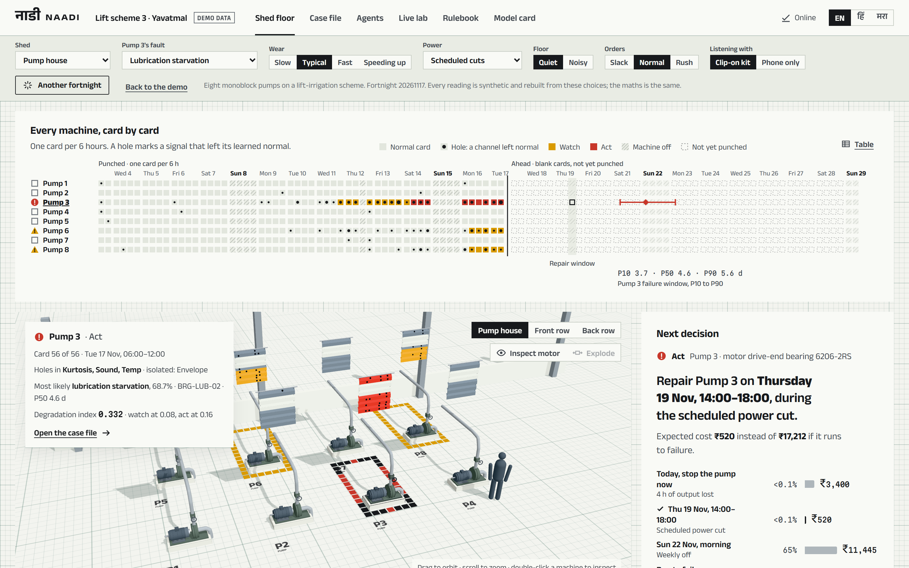
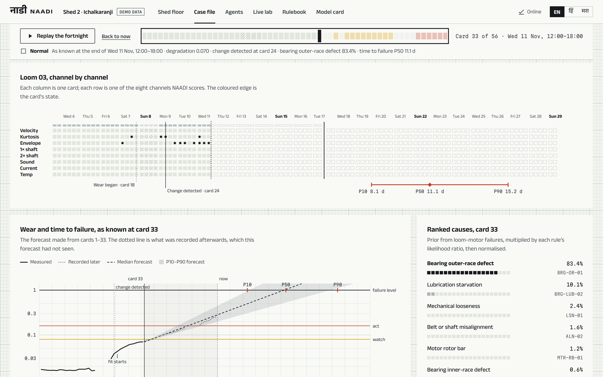
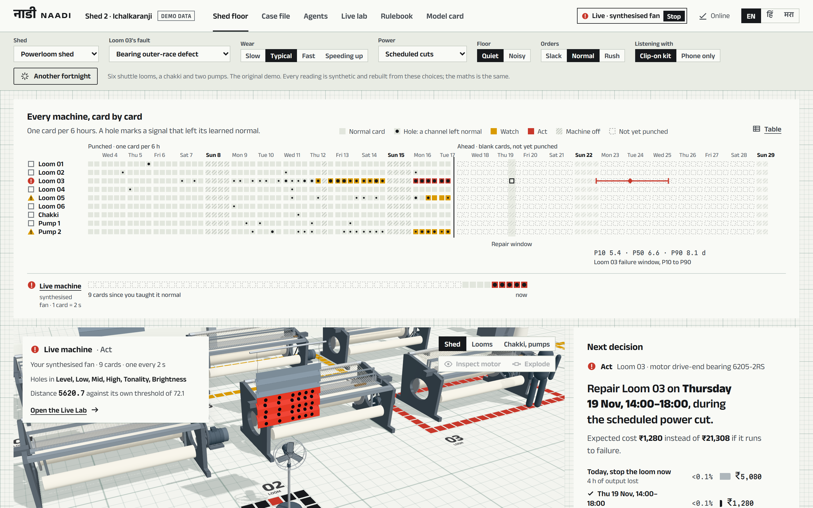
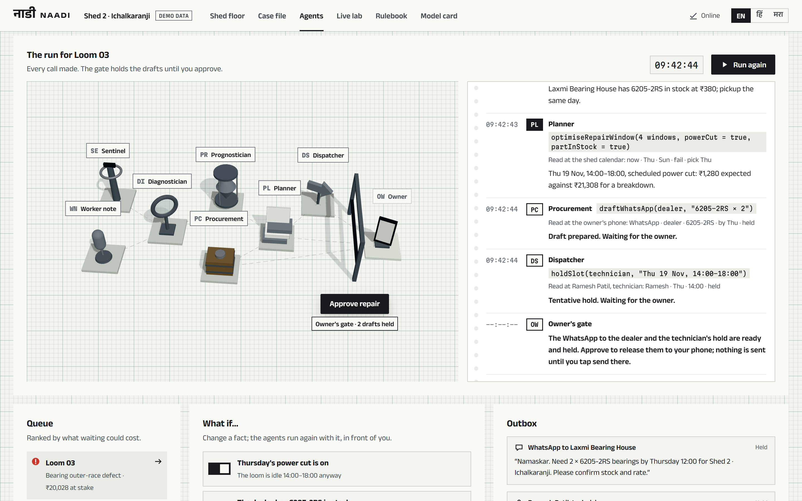
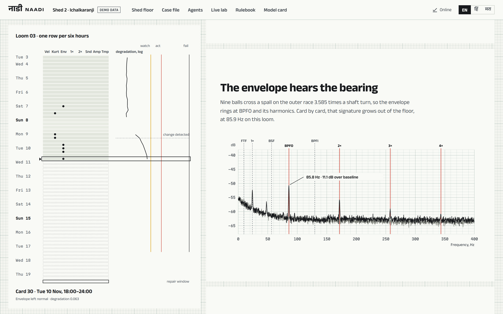
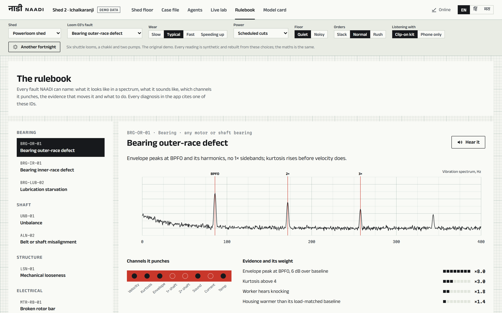

<p align="center">
  
</p>

<p align="center">
  <b>नाडी · NAADI</b> reads a machine's pulse the way a mill owner already does, by sound and feel,<br>
  and turns it into physics, a time to failure, a decision priced in rupees, and a repair the owner approves.
</p>

<p align="center">
  
  
  
  
  
  
</p>

<p align="center">
  Built for <b>HackKumbh Nagpur · Track 4.3 · Agentic AI</b>: <i>small factories lose production to breakdowns they cannot see coming.</i>
</p>

---

## The problem, in one paragraph

Powerlooms, flour mills, pump sets and small machine shops run second-hand machines with no condition monitoring and no maintenance team. The owner *is* the maintenance department and judges health by sound and feel. Machines run until they fail; then whichever mechanic is free gets called and someone is sent to town for the part. Every day of downtime costs lost output, missed deliveries, emergency part prices and wages for workers standing idle. And there is no labelled fault data, so anything useful has to learn from weeks of **normal** running, on ageing machines, **offline**, while the decision to stop production stays with the owner.

## What NAADI does

| | |
|---|---|
| **Listens** | A ₹1,500 clip-on kit or just a phone hears vibration, sound, motor current and temperature. Workers' voice notes count as evidence. |
| **Learns normal, per machine** | No fault labels: each machine learns its own healthy band per operating regime. A six-hour card gets a **hole** for every channel that left normal. |
| **Explains with physics** | The bearing number on the motor plate gives the fault frequencies (BPFO, BPFI, BSF, FTF). Causes are ranked by Bayes over a cited rulebook. |
| **Projects time to failure** | A change-point detector finds when wear began; a growth fit and 2,000 Monte Carlo runs give P10 / P50 / P90 days left, calibrated on 240 simulated run-to-failure bearings. |
| **Prices the decision** | Every repair window gets an expected cost in rupees. Scheduled power cuts and Sundays become free repair time. |
| **Prepares, never acts** | Agents draft the dealer's WhatsApp and hold the technician's slot. **Nothing leaves the shed until the owner approves.** |

## See it

<p align="center">
  
  <br><sub><b>Shed floor.</b> Nine machines, 56 six-hour cards each, 12 days of blank cards ahead. Loom 03's chain has darkened; the decision panel prices four repair windows. The setup bar above it rebuilds everything from another shed, fault, wear, power, floor, order book or sensor kit.</sub>
</p>

<p align="center">
  
  <br><sub><b>Another shed.</b> The pump house with starved grease on Pump 3: its own machines, bearing, motor speed, costs and camera views, read by the same maths. <a href="docs/13-setups.md">docs/13</a> lists every choice.</sub>
</p>

<table>
  <tr>
    <td width="50%"><br><sub><b>Inspect and explode.</b> Double-click a loom: the motor turns x-ray, the 6205 bearing's balls orbit at the cage frequency and the spall flashes on every pass.</sub></td>
    <td width="50%"><br><sub><b>Case file.</b> The envelope spectrum on data-aligned point paper. Drag shaft speed and every fault cursor slides; the bearing drawing turns with it.</sub></td>
  </tr>
  <tr>
    <td colspan="2"><br><sub><b>Channel by channel.</b> Envelope holes appear first, then kurtosis, velocity, sound and temperature: the order a bearing fails in. Below, the wear forecast and the Bayesian ranking.</sub></td>
  </tr>
  <tr>
    <td colspan="2"><br><sub><b>Replay the case.</b> Scrub back to any card and the whole case file shows what NAADI knew that day: the BPFO family growing out of the floor, the forecast made from the cards seen so far with what happened next drawn faint, the causes ranked as they were.</sub></td>
  </tr>
  <tr>
    <td width="50%"><br><sub><b>Lab → shed.</b> Teach your phone a fan's normal and put it on the floor as a tenth machine: its own chain, floor paint, readout and a row in the record where one card is two seconds.</sub></td>
    <td width="50%"><br><sub><b>Model card.</b> 240 simulated bearings run to failure in your browser: warning time, calibration, false alarms and rupees, and the switch that shows where it breaks.</sub></td>
  </tr>
  <tr>
    <td width="50%"><br><sub><b>Live Lab.</b> Your phone's microphone as a sensor. It learns normal in 20 s, then punches a card every 2 s. Add a bearing fault and watch the distance cross its threshold.</sub></td>
    <td width="50%"><br><sub><b>The agents, live.</b> Seven agents stand in 3D where their jobs are. A punched card travels each handoff, the acting agent rises, the tape prints what each call read and returned, and the owner's gate holds both drafts until you approve.</sub></td>
  </tr>
  <tr>
    <td width="50%"><br><sub><b>A fortnight in one scroll.</b> Loom 03's record is pinned on the left, a row per six hours beside its degradation trace. It opens fully punched, then replays from card 1 as you scroll; each chapter (the card, normal, the change caught, the spectrum, the forecast, the causes, the rupees, the agents) is computed as of the row being read.</sub></td>
    <td width="50%"><br><sub><b>Rulebook.</b> Ten fault signatures you can see and hear, each with the channels it punches, its evidence weights and what to do.</sub></td>
  </tr>
</table>

## Try it

```bash
npm install
npm run dev        # http://localhost:3000
```

| Route | What to try |
|---|---|
| [`/`](src/components/home/Overview.tsx) | Scroll: Loom 03's fortnight feeds through the reading head card by card, and every chapter's figure follows the card under the needles. Approve the repair at the end and the last card is punched. |
| [`/floor`](src/app/floor/page.tsx) | Press **Replay the fortnight** and watch every chain punch itself card by card. Hover any card. Click a machine in 3D, in the record or in the *Every machine, now* tiles. Double-click a loom, then **Explode**. Switch to हिं or मरा. |
| [`/machine/L03`](src/components/case/CaseFile.tsx) | Drag the **replay** under the case head back to card 25 and forward again: the spectrum, the spall, the forecast and the ranked causes all follow. Drag **Shaft speed** off 1,437 rpm and watch the cursors miss the peaks. Press **Now, demodulated** to hear the knock. Approve the repair. |
| `/machine/P02`, `/machine/C01`, … | Every machine has an honest record from the same engine: its own channel chain, wear and recommendation, or "nothing to act on". |
| [`/agents`](src/components/agents/AgentConsole.tsx) | **Run the agents** and watch the work travel between seven 3D agents while the tape prints each call; approve at the owner's gate. Then switch off *Thursday's power cut* or *The dealer has 6205-2RS in stock* and watch the plan move to Sunday. With a key set, **Phrase with Claude** writes the owner's note in Hindi or Marathi, numbers checked. |
| [`/lab`](src/components/lab/LiveLab.tsx) | **Use the microphone** against a running fan (or the synthesised one), **Learn normal**, then touch the fan or **Add a bearing fault**. **Put it on the shed floor** and open the floor: it is the tenth machine. Every session is saved on the device; **Resume** one later without learning again. |
| [`/model`](src/components/model/ModelCard.tsx) | Read how far to trust the forecast, then switch on **Wear accelerates** to see where it breaks, or **The first version's forecast** to see what the study fixed. |
| [`/rulebook`](src/components/rulebook/Rulebook.tsx) | Pick any of ten faults to see its spectrum, the channels it punches and its evidence weights; press **Hear it**. |

**Choose the shed and the fortnight.** The bar under the header sets the kind of shed (a powerloom shed, a flour mill or a pump house, each with its own machines, motor, bearing and costs), how full the order book is, whether a clip-on kit or only a phone is listening, what its hero machine develops (or a healthy fortnight where NAADI should say nothing) (outer or inner race, unbalance, misalignment, starved grease, looseness), how fast it wears, how the power behaves and how noisy the floor is; *Another fortnight* draws a new seed. Every page rebuilds from it, and the address bar keeps it, so `/machine/L03?fault=unb&wear=fast` or `/floor?shed=pumphouse` is a link anyone can open. *Back to the demo* restores the default story. See [docs/13](docs/13-setups.md).

**Offline.** Open any page once online and the service worker keeps every page on the device; with no signal the header says *Offline · running from this device* and everything still works, including your approval and the decision log. Check it with `npm run build && npx next start -p 3002` and `node scripts/check-offline.mjs`.

**Optional: the narrator.** Set `ANTHROPIC_API_KEY` in `.env.local` (or in the Vercel project's environment) to let Claude phrase the owner's note. Without it, the app uses a template and says so. See [docs/12](docs/12-narrator.md).

## How it works

<p align="center"></p>

The four equations that carry the demo (full derivations in [docs/03-signal-to-decision.md](docs/03-signal-to-decision.md)):

$$\text{BPFO} = \frac{n}{2}\,f_r\left(1 - \frac{d}{D}\cos\varphi\right) \qquad \text{6205: } n = 9,\ d/D = 0.203 \ \Rightarrow\ 3.585\,f_r = 85.8\ \text{Hz at 1,437 rpm}$$

$$d(t) = d_0\,e^{\,b\,(t - t_0)}, \qquad T_{\text{fail}} = \frac{\ln(1/d_{\text{now}})}{b}, \quad b \sim \text{LogNormal}\big(\ln \hat b,\ \sigma_b\big), \quad \sigma_b = \sqrt{\big(\sqrt3\,\text{se}/\hat b\big)^2 + 0.15^2}$$

$$\mathbb{E}[C(t)] = F(t)\,C_{\text{breakdown}} + \big(1 - F(t)\big)\big(C_{\text{planned}} + \text{lost output}(t)\big)$$

$$P(h \mid e) \propto P(h)\prod_i \mathrm{LR}_i(h) \qquad \text{(outer-race defect: 86.5\% → 88.6\% with the weaver's note)}$$

Every number on screen is computed live from these, in the browser, by [`src/lib/model`](src/lib/model). Agents never do arithmetic: they call deterministic tools and write drafts ([docs/04-agents.md](docs/04-agents.md)).

## Architecture

<p align="center"></p>

| Layer | Choice | Why |
|---|---|---|
| App | **Next.js 16** (App Router, Turbopack), **React 19**, TypeScript strict | Vercel-native; static pages for every machine |
| 3D twin | **three.js r187**, imperative engine in [`src/lib/twin/engine.ts`](src/lib/twin/engine.ts) wrapped by a React host | Frame-level control of instancing, x-ray materials and disposal |
| Charts | Hand-built SVG and canvas on data-aligned point paper | Analyst-grade spectra and records; no generic chart look |
| State | **zustand** | One store for language, replay index, selection and the owner's decision |
| Type | **Anek Latin + Anek Devanagari** (Ek Type, Mumbai), **Martian Mono** via `next/font` | One family for English, Hindi and Marathi; mono only for measurements |
| Sound | Web Audio, physically modelled | Healthy hum, the bearing knock, and the demodulated envelope |

## The design language

NAADI's look comes from the powerloom shed itself: **naksha point paper** (the graph paper weave designs are drawn on) and **jacquard punched-card chains** (the loom's own memory). The page is a single sheet of point paper; content sits in painted cells; colour appears only where a machine must be watched (amber, triangle) or acted on (vermilion, circle). Motion steps like a jacquard cylinder turning one card. The full system, tokens and rules are in [DESIGN.md](DESIGN.md) and [docs/06-design-system.md](docs/06-design-system.md).

## Repository map

```
naadi/
├─ src/
│  ├─ app/                    routes: /, /floor, /machine/[id], /agents, /lab, /rulebook, /model, /api/narrate
│  ├─ components/
│  │  ├─ shell/               header, language switch, icons (ISO 3864 status shapes), tooltip layer
│  │  ├─ home/                the overview: hanging chain, two bills, how it works, three doors, QR code
│  │  ├─ record/              the card record (drawdown) and shared card geometry
│  │  ├─ twin/                React host for the 3D engine, inspect and explode controls, part labels
│  │  ├─ floor/               floor view, readout, scrub bar with a data track, decision panel, the live machine's row
│  │  ├─ case/                spectrum, bearing section, channel chain, wear forecast, sound, agent trace (all replayable)
│  │  ├─ decide/              repair-window costs, posterior cells, evidence, approve / not now
│  │  ├─ agents/              the agent console: the 3D agents, the printed tape, what-ifs, outbox, the owner's note
│  │  ├─ model/               the model card: calibration, warning time, forecast against truth, rupees
│  │  ├─ lab/                 the Live Lab: controls, live canvases, score history, live cards
│  │  └─ rulebook/            the rulebook explorer with signature spectra and sounds
│  └─ lib/
│     ├─ model/               the physics and maths: shed, bearing, spectrum, change point, Monte Carlo, rupees, Bayes,
│     │                        replay.ts (the model as of any card), study.ts (the simulation study)
│     ├─ twin/engine.ts       the three.js shed: machines, chains, floor paint, x-ray, explode, picking
│     ├─ lab/                 live features, Ledoit–Wolf, Mahalanobis, threshold, live cards; one engine per tab
│     ├─ agents/              the agent run as data, with what-ifs; the owner's facts and the number check
│     ├─ rulebook.ts          ten fault rules with evidence, actions, sources, spectra and sounds
│     ├─ audio/synth.ts       bearing sound synthesis and playback
│     ├─ i18n.ts, store.ts    English / हिंदी / मराठी, app state
├─ docs/                      the design and engineering record (start at docs/README.md)
├─ design/preview/            the original static design preview the app grew from
├─ scripts/                   screenshot capture, diagram rendering, model checks
├─ DESIGN.md, PRODUCT.md      the design system and the product record
```

## Documentation

| Doc | What it covers |
|---|---|
| [01 · Problem and users](docs/01-problem-and-users.md) | The brief, who lives with it, field questions mapped to features, positioning |
| [02 · Architecture](docs/02-architecture.md) | System, app and data flow, component tree, state, routes, performance |
| [03 · From signal to decision](docs/03-signal-to-decision.md) | Every equation: features, bearing physics, tail probabilities, change points, Monte Carlo, rupees, Bayes |
| [04 · Agents](docs/04-agents.md) | The roster, tools, gates, the run as data, what-ifs, where an LLM fits and where it must not |
| [05 · The digital twin](docs/05-digital-twin.md) | Scene, card chains, floor paint, inspection, exploded motor, camera, budgets |
| [06 · Design system](docs/06-design-system.md) | The naksha world: tokens, rules, components, why it is not a dark dashboard |
| [07 · Data and validation](docs/07-data-and-validation.md) | How the demo data is generated, the replay spectrum, public datasets still to run |
| [08 · Roadmap](docs/08-roadmap.md) | What is built, what is next, what is later |
| [09 · Demo script](docs/09-demo-script.md) | Four minutes, beat by beat |
| [10 · Live Lab](docs/10-live-lab.md) | The phone as a sensor, and the tenth machine on the floor |
| [11 · Model card](docs/11-model-card.md) | The simulation study: calibration, warning time, false alarms, rupees, what it changed, where it breaks |
| [12 · Narrator](docs/12-narrator.md) | Claude phrases the owner's note from computed facts; a checker refuses any new number |
| [13 · Setups](docs/13-setups.md) | Three sheds, six faults, four wear rates, three power patterns, two floors and any seed; what each gives and how the evidence follows |
| [Ideation](docs/IDEATION.md) | The original research and ideation that started the project |

## Honesty notes

- **All readings, names and prices are synthetic demo data** and are labelled as such in the UI. The setup bar changes the synthetic data, never the maths that reads it. The physics and maths that turn them into decisions are real and run live.
- The Hindi and Marathi strings are machine-drafted and need a native speaker's review.
- The forecast is calibrated on **simulated** run-to-failure bearings from the demo's own model ([docs/11](docs/11-model-card.md)); it has not yet been scored on public recordings (NASA IMS, CWRU, MIMII), and it is late when wear accelerates. The model card shows both.
- The narrator only phrases computed facts and is refused if it adds a number; it was built and checked without a key, and has not been run live in this build.
- No field pilots, customers or measured results exist yet. Nothing in this repository claims otherwise.
