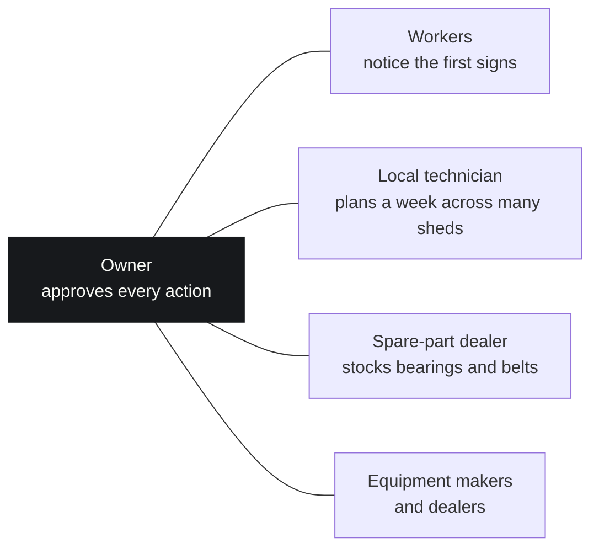

# 01 · Problem and users

> **HackKumbh Nagpur · 4.3 · Agentic AI.** *Small factories lose production to breakdowns they cannot see coming.*

## The problem

Powerlooms, flour mills, pump sets and small machine shops run old equipment without condition monitoring or a maintenance team. Breakdowns are unplanned, spare parts are sourced in a hurry, and every day of downtime eats into thin margins.

Today a machine runs until it fails. The owner calls whichever mechanic is free and sends someone to town for the part. The cost lands in four places at once:

| Cost | How it shows up in NAADI |
|---|---|
| Lost production days | `downtimeH × (margin + idle wages)` in the breakdown bill |
| Missed deliveries | the reason a planned window beats a breakdown even when both cost the same part |
| Emergency part prices | a 60% rush premium on the part in the breakdown bill |
| Wages for idle workers | ₹250 an hour folded into every lost hour |

### What makes it hard

1. **No labelled fault data.** Nobody has a library of "this is what Loom 03 sounds like before its bearing fails". Anything useful must learn from weeks of *normal* running.
2. **Ageing, second-hand machines.** There is no global "healthy" for a twenty-year-old loom. Each machine must be compared with its own normal, and its normal changes with load.
3. **Offline.** Power and phone signal on a shed floor are patchy. The maths has to run at the edge or in the browser.
4. **The owner decides.** Any decision to stop production rests with the owner. The system may recommend and prepare; it may not act.

## Who lives with it

| Who | Their job | What NAADI gives them |
|---|---|---|
| **Owner** (primary) | keep machines earning; decide when to stop one | one decision at a time, priced in rupees, with the physics behind it and an approve button |
| **Workers** | run the machines; hear the change first | a voice note in Marathi or Hindi that counts as evidence ("खट-खट आवाज येतोय") |
| **Technician** | fix machines across many sheds | a held slot in a planned window instead of an emergency call (technician week view: *later*) |
| **Dealer** | stock the right parts | a WhatsApp draft with the exact part number before the rush (dealer demand view: *later*) |
| **Judges** (demo audience) | understand it in minutes, on a laptop or a phone | a shed they can replay, a motor they can x-ray, a spectrum they can drag |

## Field questions, mapped to features

The brief lists six questions to take into the field. Each one is a feature in NAADI.

| Field question | Feature | Status |
|---|---|---|
| Which machine failed last, how long was it down, what did it cost? | the breakdown bill in every case file: hours down, margin, idle wages, rush part, call-out, secondary damage | **Built** (defaults), onboarding interview *Next* |
| What did workers notice before it failed? | worker voice notes become evidence with a likelihood ratio in the Bayesian ranking | **Built** (one note in the demo) |
| How long does it take to find a technician and a part? | dealer stock check and lead time in the planner; an out-of-stock what-if re-plans the window | **Built**: the agent console's *dealer in stock* switch re-plans live |
| Are there idle windows when repairs could happen without losing output? | Sundays and scheduled power cuts are priced as zero-loss repair windows | **Built** |
| What is the power and phone signal like on the shop floor? | in-browser maths, offline-first design, SMS fallback | maths **Built**; service worker and SMS *Later* |
| What record of past repairs exists? | a repair log that updates the priors of the rulebook | *Later* |

> **Following the money.** *A technician who knew which machines were about to fail would plan his week very differently.* NAADI's held technician slot is the first piece of that; the technician's routed week is on the [roadmap](08-roadmap.md).

## Positioning

NAADI is industrial-grade condition monitoring, normally sold to large plants, delivered on a ₹1,500 clip-on kit or a phone, and working offline.

| | Large-plant platforms (Augury, Tractian) | Typical hackathon dashboard | **NAADI** |
|---|---|---|---|
| Hardware | proprietary sensors, subscription | none | ₹1,500 ESP32 kit, or any phone |
| Learning | trained on billions of fleet samples | a pretrained classifier | per-machine normal, no labels needed |
| Diagnosis | proprietary models plus human analysts | a label and a confidence | physics (bearing tones) plus a cited rulebook ranked by Bayes |
| Output | alerts and work orders | charts | one decision priced in rupees, with idle windows and part lead times |
| Who decides | the plant | unclear | the owner, through an explicit approval gate |
| Language | English | English | English, हिंदी, मराठी |

The positioning claim a neighbouring product cannot copy is the combination of three things: **physics before black boxes, every recommendation priced in rupees with the risk stated, and repairs scheduled into the shed's own idle time**.

## Product principles

1. **Physics before black boxes.** Every diagnosis shows its evidence and its rule citations.
2. **The owner decides; agents prepare.**
3. **Every recommendation is priced in rupees,** with the risk of waiting stated.
4. **Works on a bad day:** offline, low power, patchy signal.
5. **Real data where it exists, labelled synthetic where it doesn't.**
