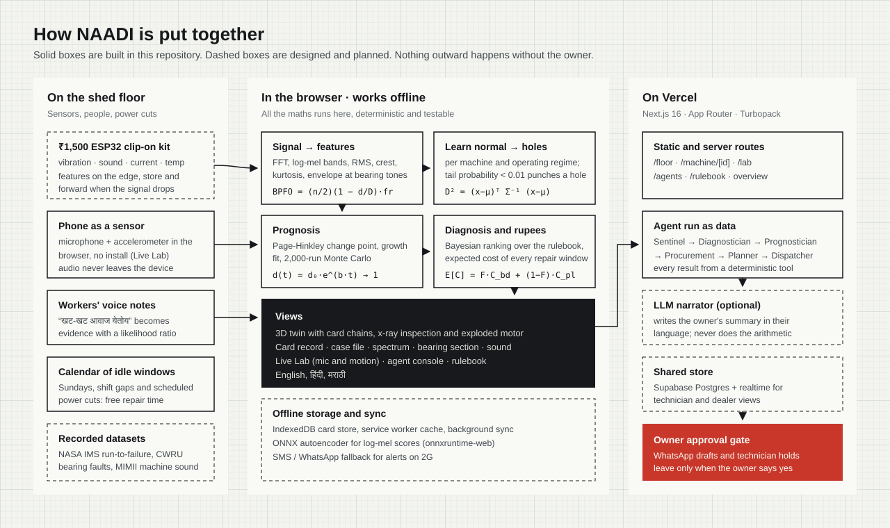
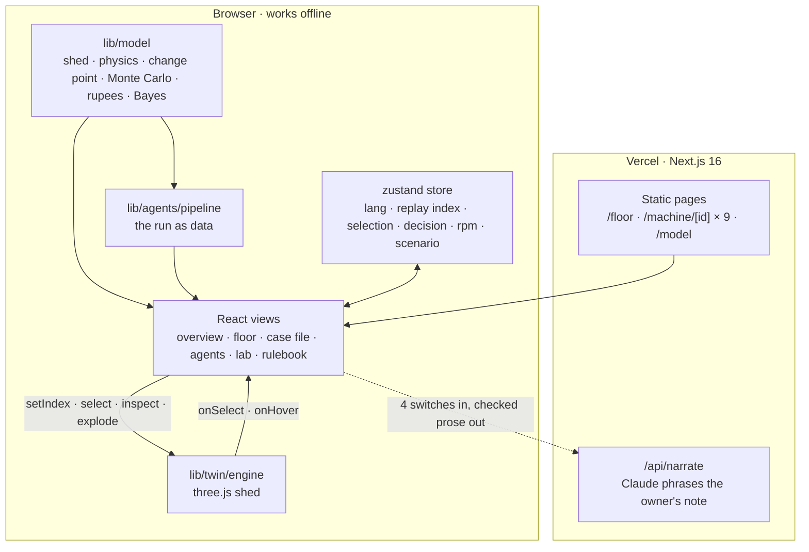
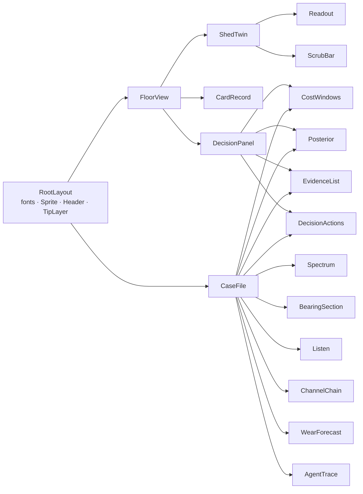
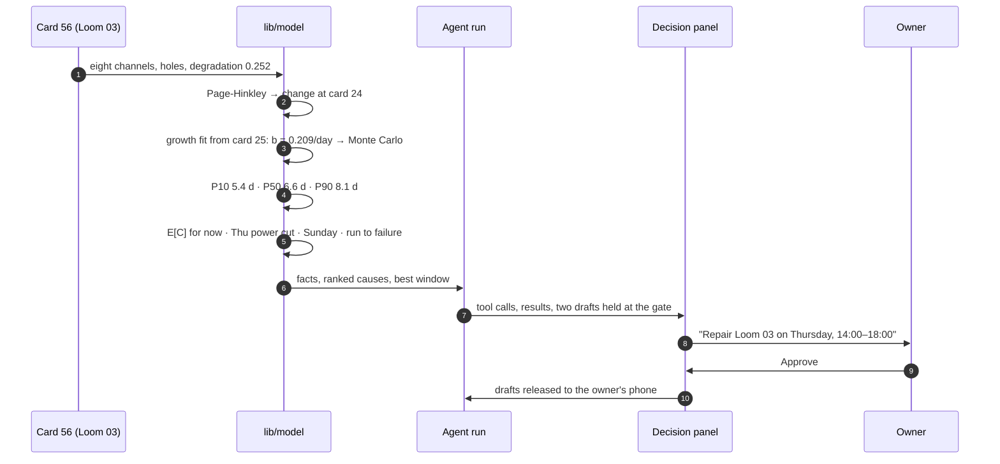

# 02 · Architecture

## Principles that shaped it

| Principle | Consequence in code |
|---|---|
| **The LLM never does arithmetic** | all numbers come from [`src/lib/model`](../src/lib/model): plain, deterministic TypeScript you can test |
| **Works offline** | the maths runs in the browser; pages are statically generated; three.js loads on demand |
| **One model, everywhere** | `getModel()` is seeded: the server and every browser build the identical shed, so pages render anywhere without drift |
| **The owner is the only actuator** | the only outward action in the UI is `decide('approved')`, and it produces drafts, not messages |
| **Frame-level control for 3D** | the twin is an imperative engine class, hosted by a thin React component |

## Runtime picture

## Routes

| Route | Rendering | Component | Notes |
|---|---|---|---|
| `/` | static | [`Overview`](../src/components/home/Overview.tsx) | the story: hanging chain, two bills, how it works, three doors, QR code to the Lab |
| `/floor` | static | [`FloorView`](../src/components/floor/FloorView.tsx) | card record, 3D twin, decision panel |
| `/machine/[id]` | static × 9 (`generateStaticParams`) | [`CaseFile`](../src/components/case/CaseFile.tsx) | Loom 03 gets the full physics case; the others get an honest record from the same engine |
| `/agents` | static | [`AgentConsole`](../src/components/agents/AgentConsole.tsx) | the run streamed step by step, what-if switches, outbox, owner gate |
| `/lab` | static | [`LiveLab`](../src/components/lab/LiveLab.tsx) | microphone or synthesised fan as a live sensor ([docs/10](10-live-lab.md)) |
| `/rulebook` | static | [`Rulebook`](../src/components/rulebook/Rulebook.tsx) | ten fault signatures with spectra, sounds, evidence and actions |
| `/model` | static, computed in the browser | [`ModelCard`](../src/components/model/ModelCard.tsx) | the simulation study, run in slices so the page never freezes ([docs/11](11-model-card.md)) |
| `/api/narrate` | dynamic (route handler) | [`route.ts`](../src/app/api/narrate/route.ts) | `GET` reports whether a key is set; `POST` phrases the owner's note with Claude, or falls back ([docs/12](12-narrator.md)) |

Next.js 16 specifics this codebase follows: `params` is a Promise (`await props.params`), Turbopack is the default for dev and build, `next lint` is gone (ESLint CLI with the flat config), and route-type helpers (`PageProps<'/machine/[id]'>`, `LayoutProps<'/'>`) are generated by `next typegen`.

## Component tree

Everything interactive is a client component. Pages are server components that only route and set metadata, so each page ships static HTML for its shell.

## State

One [zustand store](../src/lib/store.ts) holds everything that more than one view reads:

| Field | Written by | Read by |
|---|---|---|
| `lang` | header language switch | every label, the decision sentence, status words |
| `index` (card 0–55) | scrub bar on the floor or in a case file | card record, 3D chains and floor paint, readout, decision panel, every case-file region that replays |
| `selected` | card record, 3D picking, watch list | twin selection contour, readout |
| `decision` (`open · approved · snoozed`) | approve / not now / undo | decision panels, card record (the booked repair card), agent trace, channel chain |
| `rpm` | case-file speed control | spectrum cursors, bearing animation, inspection labels in 3D |
| `scenario`, `useNote` | agent console what-if switches | the agent run, the planner, the outbox drafts, the owner's note |
| `labOnFloor` | the Live Lab's *Put it on the shed floor* | the 3D fan, the live row under the card record, the header's Live chip; `Stop` clears it and releases the microphone |

A second tiny store, `useTip`, drives the single app-wide tooltip ([`TipLayer`](../src/components/shell/TipLayer.tsx)). Tooltips take text only, never HTML.

## The model layer

[`src/lib/model`](../src/lib/model) is the heart of the app and has no React or DOM dependency:

| File | Responsibility |
|---|---|
| [`core.ts`](../src/lib/model/core.ts) | seeded RNG, demo clock in IST, card time, thresholds, rupee and percent formatting |
| [`shed.ts`](../src/lib/model/shed.ts) | nine machines, fault profiles, card generation, Page-Hinkley, growth fit, where the fit starts, the forecast, isolated-hole logic |
| [`physics.ts`](../src/lib/model/physics.ts) | 6205 geometry, defect frequencies, envelope spectrum, cursor fit, speed from the 1× peak, tone table |
| [`decide.ts`](../src/lib/model/decide.ts) | Monte Carlo time to failure, expected cost per window with scenarios, rulebook hypotheses and Bayes |
| [`replay.ts`](../src/lib/model/replay.ts) | the model as of any card: change point, forecast, severity, spectrum, evidence and ranking from cards 1 to k |
| [`study.ts`](../src/lib/model/study.ts) | the simulation study behind the model card, as an incremental runner |
| [`index.ts`](../src/lib/model/index.ts) | `getModel()`: builds once, caches, exposes the shed, spectrum, evidence, posteriors and costs |

## Data flow for one decision

## Performance budget

| Item | Budget | How |
|---|---|---|
| First paint of `/floor` | static HTML, no 3D blocking | three.js imported on demand inside an effect |
| 3D draw calls | ~ 600 meshes, 4 instanced meshes | card chains, holes and floor cells are each one `InstancedMesh` |
| 3D frame | paused when off screen | `IntersectionObserver` starts and stops the loop |
| Card record | 9 × 104 cells | plain SVG, memoised, re-rendered only on index, selection or decision changes |
| Spectrum | 1,601 points × 2 traces | paths memoised per width; cursors re-render alone when speed changes |

## Repository conventions

- TypeScript `strict`; ESLint flat config from `eslint-config-next`.
- `npm run typecheck`, `npm run lint`, `npm run build` must pass before a push.
- `node scripts/screenshots.mjs` re-captures the README screenshots from a running dev server with the local Chrome (software WebGL).
