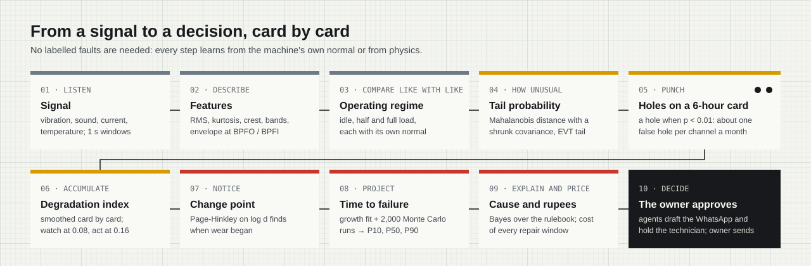

# 03 · From signal to decision

This document gives every equation NAADI uses, in the order a reading travels. Numbers in **bold** are what the current build computes for the demo shed (run `npm run test:model` to reproduce them). Where the demo simulates a step that the field build will measure, the section says so.

---

## 1 · Windows and features

A sensor stream $x[n]$ is cut into one-second windows (Hann, 50% overlap). Each window becomes a feature vector:

| Feature | Definition | What it catches |
|---|---|---|
| RMS | $\sqrt{\tfrac1N\sum x^2}$ | overall energy, load |
| Crest factor | $\max\lvert x\rvert / \text{RMS}$ | impacts |
| Kurtosis | $\kappa = \mathbb{E}[(x-\mu)^4]/\sigma^4$ | impulsiveness; ≈ 3 when healthy, > 4 with spalls |
| Band energies | $\sum_{k\in B} \lvert X[k]\rvert^2$ over log-spaced bands | where energy moved |
| Velocity RMS | integrate acceleration, RMS over 10–1000 Hz | ISO 10816 severity zones A–D (a day-zero rule that needs no learning) |
| Envelope tones | envelope spectrum amplitude at BPFO, BPFI, BSF, FTF | bearing defects (section 3) |
| Log-mel score | autoencoder reconstruction error on 64 mel bands | sound anomalies (field build) |

Eight of these become the eight **channels** printed on every card: velocity, kurtosis, envelope, 1× shaft, 2× shaft, sound, current, temperature.

## 2 · Bearing physics

A rolling bearing with $n$ balls of diameter $d$ on a pitch circle $D$, contact angle $\varphi$, on a shaft turning at $f_r$, produces four characteristic frequencies:

$$
\begin{aligned}
\text{FTF} &= \tfrac{f_r}{2}\left(1 - \tfrac{d}{D}\cos\varphi\right) &&\text{cage (fundamental train)}\\
\text{BPFO} &= \tfrac{n f_r}{2}\left(1 - \tfrac{d}{D}\cos\varphi\right) &&\text{a ball passing a fixed defect on the outer race}\\
\text{BPFI} &= \tfrac{n f_r}{2}\left(1 + \tfrac{d}{D}\cos\varphi\right) &&\text{a ball passing a defect on the rotating inner race}\\
\text{BSF} &= \tfrac{D f_r}{2d}\left(1 - \left(\tfrac{d}{D}\cos\varphi\right)^2\right) &&\text{ball spin}
\end{aligned}
$$

For the 6205-2RS on Loom 03's motor ($n = 9$, $d = 7.94$ mm, $D = 39.04$ mm, $\varphi = 0$, so $d/D = 0.2034$):

| Tone | × shaft speed | at **1,437 rpm** ($f_r$ = 23.95 Hz) |
|---|---|---|
| FTF | **0.3983** | 9.54 Hz |
| BSF | **2.3567** | 56.4 Hz |
| BPFO | **3.5848** | **85.9 Hz** |
| BPFI | **5.4152** | 129.7 Hz |

The owner types the bearing number printed on the motor plate; the geometry comes from a lookup table; the cursors appear on the spectrum. That is the whole trick: a diagnosis anyone can check with a calculator.

**Speed matters.** The shaft speed is recovered from the 1× peak with parabolic interpolation between FFT bins: **1,437 rpm** against the 1,440 on the nameplate (an induction motor slips under load). In the case file the cursors fit the measured BPFO family at **12.2 dB** above the local floor; move the speed 3% and the fit collapses to **0.5 dB**. The speed slider exists to make that visible.

## 3 · Envelope analysis

A spall does not make a tone at BPFO; it makes an impact every $1/\text{BPFO}$ seconds, and each impact rings the housing at a structural resonance (a few kHz). The repetition rate hides in the *envelope*:

1. band-pass around the resonance (chosen by the kurtogram: the band with the highest spectral kurtosis),
2. take the analytic signal's magnitude $\lvert x + j\,\mathcal{H}\{x\}\rvert$ (Hilbert transform),
3. FFT the envelope.

Peaks at BPFO, 2×, 3× BPFO, with no 1× sidebands, say *outer race*. BPFI with ±1× sidebands would say *inner race*. In the demo the envelope spectrum is synthesised from that physics (peaks of 17.5, 12.5, 8 and 4.5 dB above floor at the BPFO harmonics, small FTF sidebands, a 1.2 dB broadband rise above 150 Hz); the case file's **Now, demodulated** button plays exactly this process on a synthesised signal, so you can hear the knock come out of the hum.

## 4 · Learning normal without labels

Each machine learns its own normal **per operating regime**: idle, half and full load are separated by a Gaussian mixture on current and speed, with $k$ chosen by BIC. Within a regime the feature vectors $x$ are scored by Mahalanobis distance:

$$D^2 = (x-\mu)^\top \hat\Sigma^{-1}(x-\mu), \qquad \hat\Sigma = (1-\alpha)\,S + \alpha\,\tfrac{\operatorname{tr} S}{p} I$$

The Ledoit–Wolf shrinkage $\alpha$ keeps $\hat\Sigma$ invertible and stable with only a few hundred healthy windows. Under normality $D^2 \sim \chi^2_p$, but real machines have heavier tails, so the tail is fitted directly: **peaks over threshold** with a generalised Pareto distribution above the 95th percentile,

$$P(D^2 > u + y \mid D^2 > u) = \left(1 + \xi \tfrac{y}{\sigma}\right)^{-1/\xi}.$$

That gives a calibrated tail probability $p$ for every window. **A channel's hole is punched on a card when its tail probability falls below 0.01** in that card's six hours. The false-hole budget is set on purpose: at a per-channel rate of 0.6% per card, a healthy machine collects about $8 \times 48 \times 0.006 \approx 2.3$ isolated holes over the 48 running cards of a fortnight. The demo's six healthy machines collected **2, 3, 2, 1, 1 and 4**. Isolated holes are labelled as such in the UI and carry no weight.

> **Demo vs field.** In the demo shed, holes are drawn from per-channel probabilities that rise along each fault's profile (a logistic in card index). In the Live Lab (*Next*) and the field build, they come from the detectors above, live.

## 5 · The degradation index

Each card's channel scores combine into a degradation index $d \in [0, 1]$, smoothed card by card (machine-off cards are skipped):

$$d_S[k] = 0.5\,d[k] + 0.5\,d_S[k-1]$$

States: **watch** at $d_S \ge 0.08$, **act** at $d_S \ge 0.16$, **failure** at $d = 1$. Loom 03 reaches watch at card 38 and act at card 52; card 56 reads **0.212**.

## 6 · When did wear begin? Page–Hinkley

On $x_k = \ln d_S[k]$, the Page–Hinkley statistic accumulates deviations above the running mean:

$$m_k = \sum_{i \le k}\left(x_i - \bar x_i - \delta\right), \qquad M_k = \min_{i\le k} m_i, \qquad \text{alarm when } m_k - M_k > \lambda$$

With $\delta = 0.05$ and $\lambda = 0.8$: wear began at **card 18** (the argmin) and the change was detected at **card 24**, two days before anyone heard anything. The channel chain draws both lines.

## 7 · How fast is it wearing? Growth fit

After the onset, $\ln d$ is linear in time if wear is exponential, so the growth rate is an ordinary least-squares slope:

$$\hat b = \frac{\sum (t_i - \bar t)(\ln d_i - \overline{\ln d})}{\sum (t_i - \bar t)^2}, \qquad \operatorname{se}(\hat b) = \sqrt{\frac{\tfrac{1}{n-2}\sum r_i^2}{\sum (t_i - \bar t)^2}}$$

Loom 03: **b = 0.216 ± 0.009 per day** over **30** running cards. On the log-scale wear chart, that is the straight line the forecast continues.

## 8 · Time to failure, as a distribution

Failure is $d = 1$. From today's $d_{\text{now}}$, the time left is $T = \ln(1/d_{\text{now}})/b$. Uncertainty enters twice:

$$b \sim \operatorname{LogNormal}\!\left(\ln\hat b,\ \sigma_b\right), \quad \sigma_b = \sqrt{\left(\tfrac{\operatorname{se}}{\hat b}\right)^2 + 0.25^2}, \qquad d_{\text{now}} \sim \mathcal N(d_S, 0.015^2)$$

The 0.25 term is a model-form prior on how wear accelerates; it is the number the NASA IMS run-to-failure data must calibrate ([docs/07](07-data-and-validation.md)). Two thousand seeded draws give the empirical distribution:

| | Loom 03 |
|---|---|
| P10 | **5.1 days** |
| P50 | **7.3 days** |
| P90 | **10.1 days** |
| P(fails within 7 days) | **44%** |

The fan on the wear chart is the P10–P90 band of $d(t) = d_{\text{now}}\,e^{b t}$; it is clipped to the plot, never clamped, so it never fakes a plateau.

## 9 · Rupees: which repair window?

A breakdown and a planned repair cost different things:

| Breakdown bill | | Planned bill | |
|---|---|---|---|
| lost output: 16 h × (₹700 margin + ₹250 idle wages) | ₹15,200 | part (6205-2RS) | ₹380 |
| rush part: ₹380 + 60% | ₹608 | labour | ₹900 |
| emergency call-out | ₹1,500 | lost output in the window | 0 to 4 h × ₹950 |
| secondary damage: 20% × ₹20,000 (shaft, housing) | ₹4,000 | | |
| **total** | **₹21,308** | **base** | **₹1,280** |

For each candidate window at time $t$, with $F(t) = P(T \le t)$ from the Monte Carlo:

$$\mathbb{E}[C(t)] = F(t)\,C_{\text{breakdown}} + \big(1 - F(t)\big)\big(C_{\text{planned}} + \text{lost output}(t)\big)$$

| Window | Fails first | Expected cost |
|---|---|---|
| Today, stop the loom now (4 h lost) | < 0.1% | ₹5,080 |
| **Thu 19 Nov, 14:00–18:00, scheduled power cut** | **< 0.1%** | **₹1,280** |
| Sun 22 Nov, weekly off | 7% | ₹2,722 |
| Run to failure | 100% | ₹21,308 |

The planner picks the cheapest **feasible** window. Scenarios change feasibility and cost, and the plan with them:

| What-if | Plan | Expected | Saving vs breakdown |
|---|---|---|---|
| base | Thursday power cut | ₹1,280 | ₹20,028 |
| power cut cancelled (Thursday now loses 4 h) | Sunday | ₹2,722 | ₹18,586 |
| part out of stock (second dealer: 3 days) | Sunday (today and Thursday impossible) | ₹2,722 | ₹18,586 |

## 10 · Why NAADI thinks it is the outer race: Bayes over the rulebook

Each rule in the rulebook carries a prior (from loom-motor failure statistics) and likelihood ratios for each kind of evidence. The posterior is

$$P(h \mid e_1, \dots, e_m) = \frac{P(h)\prod_i \mathrm{LR}_i(h)}{\sum_{h'} P(h')\prod_i \mathrm{LR}_i(h')}$$

| Evidence | Outer race | Lubrication | Looseness | Inner race | Misalignment | Unbalance |
|---|---|---|---|---|---|---|
| prior | 0.18 | 0.14 | 0.10 | 0.10 | 0.17 | 0.16 |
| envelope peak at BPFO, 2× and 3× | **× 8.0** | × 1.5 | × 0.7 | × 0.6 | × 0.4 | × 0.3 |
| kurtosis 5.7 (baseline 3.1) | × 3.0 | × 1.8 | × 1.5 | × 3.0 | × 0.8 | × 0.6 |
| weaver's note "khat-khat" | × 1.8 | × 1.5 | × 1.6 | × 1.8 | × 1.2 | × 0.8 |
| housing +6.1 °C | × 1.4 | × 2.5 | × 1.0 | × 1.4 | × 1.3 | × 1.0 |
| no peak at BPFI | × 1.2 | × 1.0 | × 1.0 | **× 0.2** | × 1.0 | × 1.0 |
| 1× unchanged | × 1.0 | × 1.0 | × 0.7 | × 1.0 | × 0.5 | **× 0.2** |

Result: **outer-race defect 88.6%**, lubrication starvation 9.6%, looseness 0.8%, inner race 0.6%, misalignment 0.3%. The weaver's note is weak evidence on purpose: it moves the posterior from **86.5%** to **88.6%**. Every row in the UI cites its rule (`BRG-OR-01 · e1` …), so the owner, a technician or a judge can audit the arithmetic.

## What is computed where

| Step | Demo shed | Live Lab (*Next*) | Field build |
|---|---|---|---|
| Features | synthesised | live from the microphone / accelerometer | ESP32 edge + browser |
| Holes | drawn from fault profiles | live tail probabilities | live tail probabilities |
| Change point, growth, Monte Carlo | **live** | — | live |
| Rupees and windows | **live** | — | live, with the shed's own calendar |
| Bayes over rules | **live** | — | live, priors updated by the repair log |
