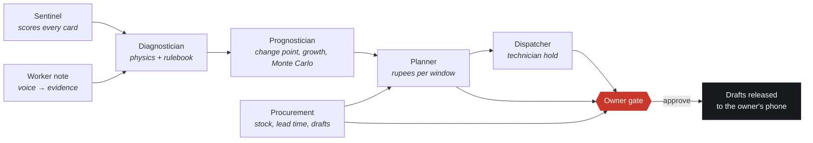
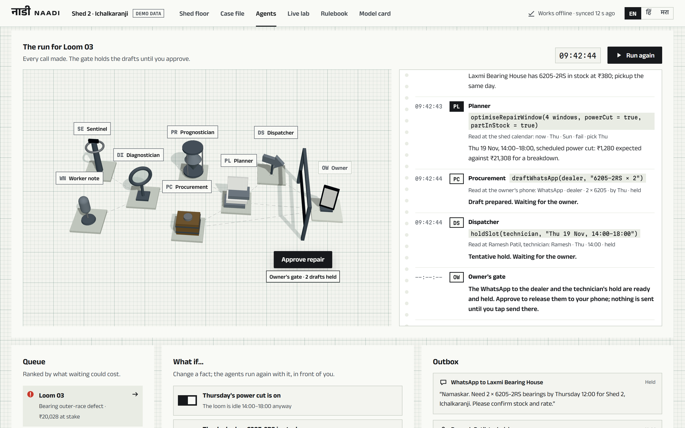
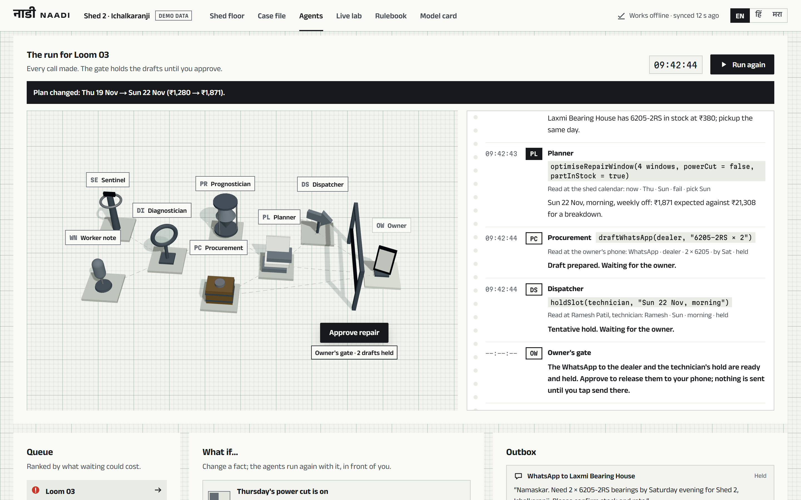

# 04 · Agents

NAADI is an *agentic* system with one hard rule: **agents never do arithmetic and never act outward on their own.** They choose which deterministic tool to call next, read its result, and write drafts. Anything that leaves the shed (a WhatsApp to the dealer, a technician booking) stops at a gate only the owner can open.

## The roster



| Agent | Trigger | Tools it may call | Writes |
|---|---|---|---|
| **Sentinel** | every card (6 h) | `scoreCard(card, regime)` | holes, degradation, state |
| **Diagnostician** | a state change or drift | `envelopePeaks(fr)`, `queryRulebook(patterns)`, `bayesRank(hypotheses, evidence)` | ranked causes with rule citations |
| **Worker note** | a voice note arrives | `transcribe(voice, lang)` | one evidence term with its likelihood ratio |
| **Prognostician** | a diagnosis at watch or act | `fitGrowth(cards)`, `monteCarlo(n)` | time-to-failure distribution |
| **Procurement** | a part is implicated | `checkStock(dealers, part)`, `draftWhatsApp(dealer, part)` | stock, lead time, a draft message |
| **Planner** | time to failure is known | `optimiseRepairWindow(windows, scenario)` | the best feasible window and its expected cost |
| **Dispatcher** | a plan exists | `holdSlot(technician, window)` | a tentative hold |
| **Owner** | always | `approve`, `notNow`, `undo` | the only outward decision |

## The run, as data

The agent run is a plain function, [`planRun(model, input)`](../src/lib/agents/pipeline.ts), that returns the list of steps the agents take and the results each tool returned. The case file renders it as a trace; the [agent console](../src/components/agents/AgentConsole.tsx) streams it step by step. Because the run is data, it is testable, replayable and identical on every device.

A step looks like this:

```ts
{
  id: 'plan',
  at: '09:42:43',
  agent: 'Planner',
  kind: 'tool',                       // 'tool' | 'gate' | 'human'
  call: 'optimiseRepairWindow(4 windows, powerCut = true, partInStock = true)',
  result: 'Thu 19 Nov, 14:00–18:00, scheduled power cut: ₹1,280 expected against ₹21,308 for a breakdown.',
}
```

The base run for Loom 03 today:

```mermaid
sequenceDiagram
  autonumber
  participant Se as Sentinel
  participant Di as Diagnostician
  participant Wn as Worker note
  participant Pr as Prognostician
  participant Pc as Procurement
  participant Pl as Planner
  participant Ds as Dispatcher
  participant Ow as Owner
  Se->>Se: scoreCard(56) → holes in velocity, envelope, sound, temp
  Se->>Di: state = act
  Di->>Di: envelopePeaks(fr = 23.95 Hz) → BPFO 85.8 Hz, 2×, 3×; no BPFI
  Di->>Di: queryRulebook(BRG-*, UNB-*, ALN-*) → BRG-OR-01 e1 e2 e4
  Wn->>Di: transcribe("खट-खट आवाज येतोय") → e3, LR 1.8
  Di->>Pr: bayesRank → outer race 88.6%
  Pr->>Pl: fitGrowth b = 0.209/day · monteCarlo → P50 6.6 d
  Pc->>Pl: checkStock → in stock, ₹380
  Pl->>Pl: optimiseRepairWindow → Thursday power cut, ₹1,280
  Pc-->>Ow: draftWhatsApp (held)
  Ds-->>Ow: holdSlot Thu 14:00–18:00 (held)
  Ow->>Ow: Approve → drafts released to the phone
```

## The run, shown live

<p align="center"></p>

On [`/agents`](../src/components/agents/AgentConsole.tsx) every role stands on point paper as its own object ([`agents3d/engine.ts`](../src/lib/agents3d/engine.ts)): the Sentinel's scanning post, the Diagnostician's lens, the weaver's voice note, the Prognostician's hourglass, Procurement's parts crate, the Planner's calendar, the Dispatcher's arrow, and the owner's phone behind a gate. Dashed cords join them along the roster's handoffs.

Press **Run** and the run plays on its own clock:

1. a small punched card travels the handoff from the agent that finished to the one that acts next, and that cord turns solid;
2. the acting agent rises on an ink plinth and its label shows the call it is making; finished agents settle on grey;
3. the tape beside it types the call, *what it read* (the inputs of that call, such as Loom 03's punched channels, the tones that stand out, the rules queried, the days at risk, the feasible and chosen windows) and the result;
4. after the two drafts, the gate stays shut with **Approve repair** on it. Approving swings the bar up and the owner's step prints.

Every what-if rewinds and runs again in front of you. The run itself is still [`planRun`](../src/lib/agents/pipeline.ts): the 3D shows the data, it does not decide anything.

## What-ifs: watching the agents re-plan

<p align="center"></p>

The planner works from a **scenario**, so the run can be re-asked under different facts. Each what-if is a deterministic re-run, not a re-prompt:

| What-if | What changes in the run | New plan |
|---|---|---|
| Power cut cancelled | Thursday now costs 4 h of output (₹3,800) | **Sunday**, ₹1,871 |
| Dealer out of stock | `checkStock` returns a 3-day lead time; today and Thursday become impossible | **Sunday**, ₹1,871 |
| Ignore the weaver's note | evidence term e3 drops; outer race 86.5% instead of 88.6% | unchanged: the physics carries the diagnosis |

The third row is deliberate: a worker's note can tip a close call, but it can never outvote the physics.

## Where an LLM fits, and where it must not

| Job | LLM? | Why |
|---|---|---|
| Arithmetic: frequencies, probabilities, costs | **Never** | must be exact, testable and identical everywhere |
| Choosing the next tool in a standard run | Optional | the standard run is a fixed policy; an LLM helps only with unusual cases |
| Turning a voice note into an evidence term | Yes (speech-to-text + extraction) | language is the hard part; the LR comes from the rulebook, not the model |
| Writing the owner's summary in Hindi or Marathi | Yes | prose in the owner's language, from facts passed in, citing rule IDs |
| Sending anything | **Never** | only the owner sends |

The narrator is built: [`/api/narrate`](../src/app/api/narrate/route.ts) sends Claude the computed facts (cause, probability, window, rupees, rule IDs) and gets back two or three sentences in the owner's language. A checker refuses any reply carrying a number the facts do not contain, and without an API key a template writes the same note, so the demo never depends on the network. The design is in [docs/12](12-narrator.md).

## Safety properties

1. **No hidden actions.** Every tool call is listed in the trace with its inputs and result.
2. **Gates are visible.** Steps of kind `gate` show *Waiting for the owner* until approval; they cannot complete on their own.
3. **Undo.** Approval and snooze are both reversible in the UI until the owner sends from the phone.
4. **Citations.** Every diagnostic claim carries a rule ID that maps to the rulebook entry and its source.
