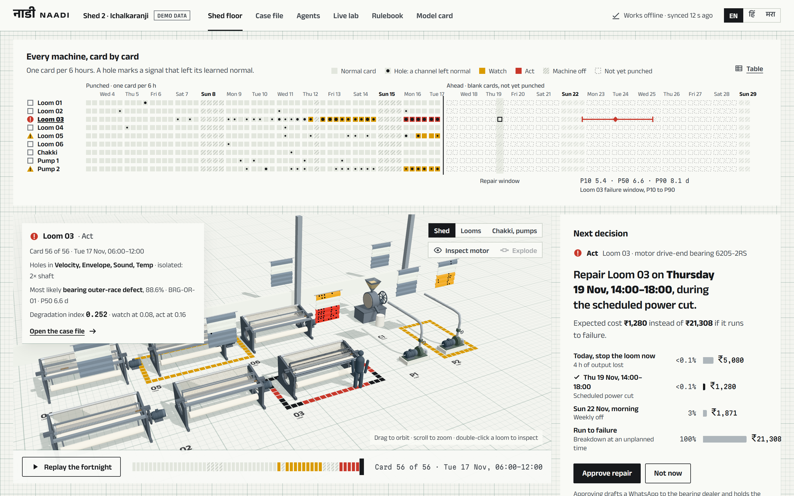
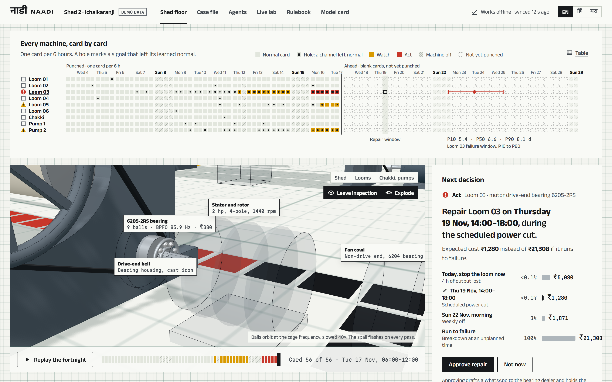

# 05 · The digital twin

The twin is the shed in 3D, standing on **the same point paper as the page**. It is built to be read, not admired: machines are matte forms with faint ink edges (a technical drawing), status is painted onto the floor, and each machine's recent history hangs above it as a punched-card chain.

## Scene

| Element | How it is built | Why |
|---|---|---|
| Floor | an unlit plane with a canvas point-paper texture (0.25 m cells, bold every 2 m), plus a `ShadowMaterial` catcher | the floor's paper is exactly the page's paper (`toneMapped: false`), so the shed seems to rise out of the UI |
| Light | hemisphere 1.25 + one directional "north light" 2.1 with PCF soft shadows; room environment at 0.42 | soft, overcast shed light; no glare, no bloom |
| Tone mapping | Neutral | colours stay true to the palette |
| Machines | procedural: six shuttle looms, a stone chakki, two monoblock pump sets | no downloads, no licences, every part addressable |
| Edges | `EdgesGeometry` ink lines at 17% opacity, 92% on the selected machine | the drawing look; selection reads as an ink contour, not a glow |
| People | one weaver beside Loom 03 | scale |

### The looms move like looms

Each loom runs at about 144 picks a minute with a random phase:

- heddle frames alternate up and down every pick (plain weave), opening the shed;
- 110 warp threads per loom follow their heddles (the eye vertices of each thread are updated per frame);
- the sley swings on its crank, and the shuttle crosses the race board while the shed is open;
- the flywheel turns; the motor drives it through a V-belt drawn on true external tangents.

## The card chains

Above every machine hang its last **twelve cards (three days)**, fan-folded like a jacquard chain and laced on two cords:

- card stock is **slate** when normal, **amber** at watch, **vermilion** at act, **pale** when the machine was off;
- each card has eight hole positions (the eight channels); a punched channel is an ink hole;
- the replay index drives the chain: scrub back to card 20 and every chain shows cards 9 to 20.

All 108 cards are one `InstancedMesh` with per-instance colour; all 864 holes are another, with unpunched holes scaled to zero. Repainting the whole shed for a new index is one pass over two instance buffers.

## Floor paint

A ring of 0.21 m painted cells (0.04 m gaps, so the paper shows between them) surrounds every footprint when the machine is at watch or act. Selection adds ink corner marks, like registration marks on a sheet. Machine numbers are painted on the floor in front of each machine in Anek Latin (read from the page's own font).

## The tenth machine: the Live Lab's fan

When a Live Lab session is put on the floor ([docs/10](10-live-lab.md)), a pedestal fan appears in the front aisle by Loom 01: base, pole, motor housing, a wire guard and three spinning blades, drawn in the same matte forms and ink edges as the rest. It is built once with the shed and kept hidden until needed, so showing it costs nothing:

- its chain hangs lower than the looms' (the fan is shorter) and takes the **last twelve live cards**, two seconds each, newest at the bottom; the shed's card and hole instance buffers carry twelve extra slots for it;
- its floor cells and corner marks follow the latest live card's state, and LIVE · YOUR SENSOR is painted in front of it;
- it is pickable as `LAB`: hover shows its state and holes, a click selects it, flies the camera to it and swaps the readout for a live one.

The engine is fed by the shared Lab engine through `setLive(on)` and `setLiveCards(cards)`; React only forwards a new card when the cards array changes, every two seconds.

## Inspect and explode

Double-click a loom (or select it and press **Inspect motor**):

1. the camera travels linearly to look in through the motor's open side;
2. the motor housing swaps to x-ray materials (13% opacity, no depth write) while its ink edges stay;
3. the drive-end bearing appears inside: two races and nine balls on the pitch circle;
4. the cage turns at **FTF × shaft speed, slowed 40×**; on Loom 03 a vermilion spall sits in the load zone and **flashes for two frames every time a ball crosses it**, which is BPFO made visible;
5. **Explode** slides the drive-end bell, the bearing, the fan cowl and the terminal box apart along the shaft, with HTML leader labels pinned to each part (part, detail, price).

The shaft speed comes from the same store as the case file's speed control, so dragging the speed there changes the cage speed and the BPFO label here.

## Camera

| Preset | Frames |
|---|---|
| Shed | the whole floor, 30° FOV (40° on phones) |
| Looms | the two rows of looms from the aisle |
| Chakki, pumps | the utilities corner |

Travel is linear with a hard stop (380 ms), never eased: the motion grammar of a carriage on a rail. The app opens on the whole shed and only flies when the selection changes.

## Picking and overlays

A raycaster against the machines' meshes resolves hover and click to a machine ID. A click (pointer travel under 5 px) selects; a drag orbits. Hover shows an ink tag with the machine's state and hole count at the current card. Labels and tags are HTML positioned from projected 3D points, so they stay crisp and translatable.

## Lifecycle and budgets

| Concern | Approach |
|---|---|
| Loading | three.js is imported inside an effect; the page paints first and shows "Laying out the shed…" |
| Off screen | an `IntersectionObserver` stops the render loop when the twin is not visible |
| Resizing | a `ResizeObserver` resizes only when the size really changed (a resize clears the canvas) and draws one frame if the loop is paused |
| Unmount | `dispose()` stops the loop, removes listeners, disposes geometries, materials, textures and the renderer |
| Reduced motion | machines stand still, camera moves become cuts, the cage stops; everything else works |
| No WebGL | a fallback note points to the card record, which carries the same data |
| Debugging | `?debug` exposes `window.__naadi.engine.renderOnce()` to draw a frame in a background tab |
