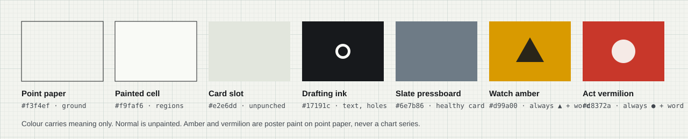

# 06 · Design system: Naksha · The Card Chain

The normative tokens and rules live in [DESIGN.md](../DESIGN.md) (with a machine-readable sidecar in [`.impeccable/design.json`](../.impeccable/design.json)). This document explains the reasoning.

## Where the look comes from

A powerloom shed already has a visual language. Weave designs are drawn on **naksha**: point paper with a fine grid and a bold line every eighth cell. Jacquard looms remember patterns as **chains of punched cards**. NAADI uses both literally and functionally:

| Shed artefact | In NAADI | Function |
|---|---|---|
| Point paper | the page ground, the 3D floor, every chart's grid | one surface for UI, data and the twin |
| Punched-card chain | the card record, the channel chain, the chains above each machine, the scrub track | time as cards: six hours each, a hole for every channel that left normal |
| Poster paint on point paper | amber and vermilion fills | status, and only status |
| Stencilled machine numbers | numbers painted on the 3D floor | wayfinding in the twin |

The direction was chosen on a decision page against six alternatives (labanotation, metro tiles, a reference manual, a catalog sleeve, a live type specimen, terminal wayfinding) and the category's own default (a dark HUD dashboard). What the declined directions donated is written into the system: exact duration, no chrome, no easing, one plot owning the field, one control remapping the field.

## Colour

| Rule | Statement |
|---|---|
| **Two paints** | Amber and vermilion appear only where a machine must be watched or acted on, always with the triangle or circle and a word. |
| **Absence** | Normal is unpainted. A healthy machine is a blank card and a quiet square outline, never green. |
| **Validated** | Status colours pass lightness, chroma and colour-blind separation checks against the paper; amber sits under 3:1 contrast by nature, so it always ships with a shape and a label. |

## Type

| Role | Face | Size / weight | Use |
|---|---|---|---|
| Headline | Anek Latin | 28 / 650 | one per view |
| Decision | Anek Latin | 21 / 600, dates at 780 | the recommended action, as a sentence |
| Title | Anek Latin | 17 / 650 | region headings |
| Body | Anek Latin | 15 / 400 | running text, sub-copy capped at 72ch |
| Label | Anek Latin | 12.5 / 500 | legends, captions, row labels |
| Measure | Martian Mono 87.5% width | 10.5–12 / 450, tabular | ticks, readouts, rule IDs, tool calls |
| Devanagari | Anek Devanagari | as the role | Hindi and Marathi everywhere |

Anek is designed by Ek Type in Mumbai and covers Latin and Devanagari in one rhythm, so switching to हिंदी or मराठी keeps the page's texture. Mono is never decoration: it appears only where something is measured or coded.

## Layout, depth, shape, motion

- **Grid:** an 8 px cell and a 64 px block; page inset 24 px, region gutters 16 px. Regions are painted cells; the grid shows only in the gutters.
- **Depth:** flat. A painted cell sits above the gridded paper because the grid disappears inside it. Shadows exist only for things floating over the 3D view (the readout, tags, the tooltip).
- **Shape:** square, like cut card stock. 2 px radius on buttons and the tooltip only. Status shapes follow ISO 3864: square normal, triangle watch, circle act, struck circle off.
- **Motion:** UI state changes step in two frames (`steps(2)`, 90–120 ms); replay advances one card every 115 ms; the camera travels linearly with a hard stop. No easing curves anywhere.

## Components worth knowing

| Component | Character |
|---|---|
| Card record | a drawdown: machines as rows, cards as columns, holes sized by count, a dashed future, a vermilion failure bracket |
| Channel chain | one machine, eight channel rows, the card's state as a painted edge, change-point lines |
| Posterior cells | twenty 8 px cells per cause (5% each), ink for the leading cause |
| Cost windows | rupee bars per repair window, the chosen one inked and ticked, impossible ones hatched |
| Scrub bar | its track is data: each card slot carries the shed's worst state for that card |
| Decision sentence | the action written as a sentence in the owner's language, with the window in bold |

## What the system refuses

Glow, neon, bloom, gradients and glass; rounded shadowed cards and nested cards; green for healthy; amber or vermilion as a chart series; easing curves; a small label above a heading; mono as a costume. These are written into [DESIGN.md](../DESIGN.md) so every new screen inherits them.
