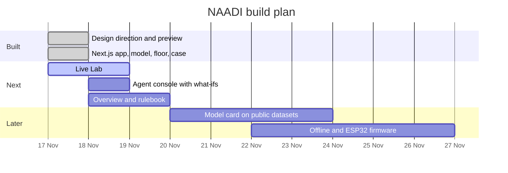

# 08 · Roadmap

Status of every planned piece, kept current with the code.

## Built

| Area | What exists | Where |
|---|---|---|
| Model | seeded shed, bearing physics, envelope spectrum, Page–Hinkley, growth fit, Monte Carlo, rupees with scenarios, Bayes over rules | [`src/lib/model`](../src/lib/model) |
| Model checks | invariants and the numbers the docs quote (`npm run test:model`) | [`scripts/check-model.ts`](../scripts/check-model.ts) |
| Shed floor | card record (9 × 56 + 48 ahead), 3D twin, chains, floor paint, camera presets, replay scrub with a data track, readout, decision panel | [`/floor`](../src/app/floor/page.tsx) |
| 3D inspection | x-ray motor, bearing with orbiting balls and a flashing spall, exploded motor with labels | [`engine.ts`](../src/lib/twin/engine.ts) |
| Case files | Loom 03's full physics case; honest records for the other eight machines | [`/machine/[id]`](../src/app/machine/[id]/page.tsx) |
| Sound | healthy, now, and demodulated bearing sounds, physically modelled | [`synth.ts`](../src/lib/audio/synth.ts) |
| Agents | the run as data with scenarios, rendered as a trace | [`pipeline.ts`](../src/lib/agents/pipeline.ts) |
| Owner decision | approve, not now, undo; drafts held until approval | [`DecisionActions`](../src/components/decide/DecisionActions.tsx) |
| Languages | English, हिंदी, मराठी (machine-drafted) | [`i18n.ts`](../src/lib/i18n.ts) |

## Next (in progress)

| Piece | What it adds |
|---|---|
| **Live Lab** `/lab` | the phone or laptop microphone (and the phone's accelerometer) as a real sensor: learn normal in 20 s, then live spectrum, waterfall, Mahalanobis score against a threshold, and cards punched live every two seconds |
| **Agent console** `/agents` | the run streamed step by step, tool by tool, with what-if switches (power cut cancelled, part out of stock, ignore the note) that make the agents re-plan in front of you |
| **Overview** `/` | the story in one page: the problem, the mechanism, the proof, and doors into the floor, the lab and the agents |
| **Rulebook** `/rulebook` | every fault signature as an interactive mini-spectrum you can see and hear |

## Later

| Piece | Notes |
|---|---|
| Model card page | IMS lead time, CWRU confusion matrix, MIMII AUC, honest limitations |
| Offline | service worker, IndexedDB card store, background sync |
| ESP32 firmware | the same feature definitions on the edge, MQTT or BLE out |
| Technician week | jobs ranked by risk × rupees across sheds, routed on OpenFreeMap |
| Dealer demand | parts × weeks heat map from summed failure probabilities |
| Narrator | LLM summary in the owner's language from computed facts, with a no-key template fallback |
| Shared store | Supabase for technician and dealer views |
| Native review | Hindi and Marathi copy by native speakers |

