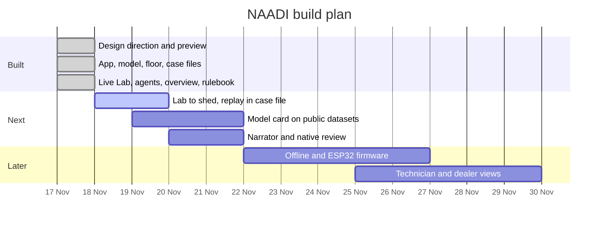

# 08 · Roadmap

Status of every planned piece, kept current with the code.

## Built

| Area | What exists | Where |
|---|---|---|
| Model | seeded shed, bearing physics, envelope spectrum, Page–Hinkley, growth fit, Monte Carlo, rupees with scenarios, Bayes over rules | [`src/lib/model`](../src/lib/model) |
| Model checks | invariants and the numbers the docs quote (`npm run test:model`) | [`scripts/check-model.ts`](../scripts/check-model.ts) |
| Overview | hanging chain that punches itself, two bills for one bearing, how it works with live figures, three doors, QR code to the Lab | [`/`](../src/components/home/Overview.tsx) |
| Shed floor | card record (9 × 56 + 48 ahead), 3D twin, chains, floor paint, camera presets, replay scrub with a data track, readout, decision panel | [`/floor`](../src/app/floor/page.tsx) |
| 3D inspection | x-ray motor, bearing with orbiting balls and a flashing spall, exploded motor with labels | [`engine.ts`](../src/lib/twin/engine.ts) |
| Case files | Loom 03's full physics case; honest records for the other eight machines | [`/machine/[id]`](../src/app/machine/[id]/page.tsx) |
| Agent console | the run streamed tool by tool, what-if switches (power cut, dealer stock, worker note), plan-change banner, outbox, owner summary in three languages | [`/agents`](../src/components/agents/AgentConsole.tsx) |
| Live Lab | microphone or synthesised fan as a live sensor; 21 features, Ledoit–Wolf, Mahalanobis, own-normal threshold, cards every 2 s, waterfall, *what changed*; motion sensor on phones | [`/lab`](../src/components/lab/LiveLab.tsx), [docs/10](10-live-lab.md) |
| Rulebook | ten fault rules with signature spectra, sounds, punched channels, evidence weights, actions and sources | [`/rulebook`](../src/components/rulebook/Rulebook.tsx) |
| Sound | healthy, now, demodulated bearing sounds; a sound for every rule | [`synth.ts`](../src/lib/audio/synth.ts), [`rulebook.ts`](../src/lib/rulebook.ts) |
| Owner decision | approve, not now, undo; drafts held until approval, everywhere the decision appears | [`DecisionActions`](../src/components/decide/DecisionActions.tsx) |
| Languages | English, हिंदी, मराठी (machine-drafted) | [`i18n.ts`](../src/lib/i18n.ts) |

## Next

| Piece | What it adds |
|---|---|
| **Lab → shed** | a "Save as a machine" button: a Live Lab session becomes a tenth machine on the floor with its own live card chain |
| **Replay in the case file** | the case file's spectrum and wear chart follow the floor's replay index, so you can watch the BPFO family grow |
| **Model card page** | IMS lead time, CWRU confusion matrix, MIMII AUC, honest limitations ([docs/07](07-data-and-validation.md)) |
| **Narrator** | an LLM phrases the owner's summary from computed facts, with the current template as the no-key fallback |
| **Native review** | Hindi and Marathi strings checked by native speakers |

## Later

| Piece | Notes |
|---|---|
| Offline | service worker, IndexedDB card store, background sync |
| ESP32 firmware | the same feature definitions on the edge, MQTT or BLE out |
| Technician week | jobs ranked by risk × rupees across sheds, routed on OpenFreeMap |
| Dealer demand | parts × weeks heat map from summed failure probabilities |
| Shared store | Supabase for technician and dealer views |
| Repair log | each repair updates the rulebook priors for that shed |

