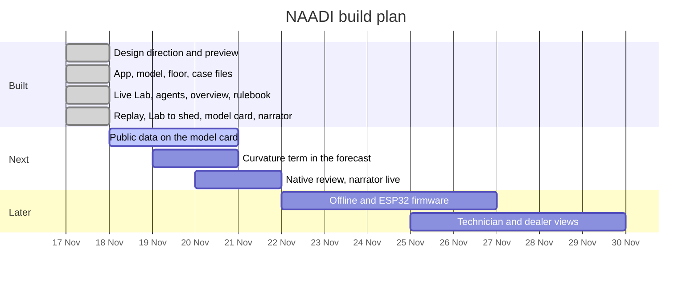

# 08 · Roadmap

Status of every planned piece, kept current with the code.

## Built

| Area | What exists | Where |
|---|---|---|
| Model | seeded shed, bearing physics, envelope spectrum, Page–Hinkley, growth fit, Monte Carlo, rupees with scenarios, Bayes over rules | [`src/lib/model`](../src/lib/model) |
| Model checks | invariants, the numbers the docs quote, replay consistency and a small calibration study (`npm run test:model`) | [`scripts/check-model.ts`](../scripts/check-model.ts) |
| Replay as of any card | change point, growth fit, Monte Carlo, evidence and ranking recomputed from cards 1 to k only | [`replay.ts`](../src/lib/model/replay.ts) |
| Calibrated forecast | fit from the first card clear of the normal band, √3 on the fit's error for smoothing, ±15% prior, tuned by the study | [`forecast`](../src/lib/model/shed.ts), [docs/11](11-model-card.md) |
| Overview | hanging chain that punches itself, two bills for one bearing, how it works with live figures, three doors, QR code to the Lab | [`/`](../src/components/home/Overview.tsx) |
| Shed floor | card record (9 × 56 + 48 ahead), 3D twin, chains, floor paint, camera presets, replay scrub with a data track, readout, decision panel | [`/floor`](../src/app/floor/page.tsx) |
| 3D inspection | x-ray motor, bearing with orbiting balls and a flashing spall, exploded motor with labels | [`engine.ts`](../src/lib/twin/engine.ts) |
| Case files | Loom 03's full physics case; honest records for the other eight machines | [`/machine/[id]`](../src/app/machine/[id]/page.tsx) |
| Replay in the case file | a sticky replay bar: the spectrum grows out of the floor, the spall grows, the chain blanks ahead, the forecast is the one made that day with what happened next drawn faint, the causes rank as they did then; costs stay priced at card 56 | [`CaseFile`](../src/components/case/CaseFile.tsx) |
| Agent console | the run streamed tool by tool, what-if switches (power cut, dealer stock, worker note), plan-change banner, outbox, owner summary in three languages | [`/agents`](../src/components/agents/AgentConsole.tsx) |
| Live Lab | microphone or synthesised fan as a live sensor; 21 features, Ledoit–Wolf, Mahalanobis, own-normal threshold, cards every 2 s, waterfall, *what changed*; motion sensor on phones | [`/lab`](../src/components/lab/LiveLab.tsx), [docs/10](10-live-lab.md) |
| Lab → shed | the Lab session becomes a tenth machine: a fan on the floor with its own live chain, floor paint and readout, a row under the card record (1 card = 2 s), a Live chip with Stop in the header | [`LiveBand`](../src/components/floor/LiveBand.tsx), [`engine.ts`](../src/lib/twin/engine.ts) |
| Model card | a simulation study run in the browser: warning time, P10–P90 calibration, false alarms, rupees under the repair policy, with switches for accelerating wear, the prior and the first version's forecast | [`/model`](../src/components/model/ModelCard.tsx), [docs/11](11-model-card.md) |
| Narrator | Claude phrases the owner's note from server-computed facts; a checker refuses any number not in the facts; template when there is no key | [`/api/narrate`](../src/app/api/narrate/route.ts), [docs/12](12-narrator.md) |
| Rulebook | ten fault rules with signature spectra, sounds, punched channels, evidence weights, actions and sources | [`/rulebook`](../src/components/rulebook/Rulebook.tsx) |
| Sound | healthy, now, demodulated bearing sounds; a sound for every rule | [`synth.ts`](../src/lib/audio/synth.ts), [`rulebook.ts`](../src/lib/rulebook.ts) |
| Owner decision | approve, not now, undo; drafts held until approval, everywhere the decision appears | [`DecisionActions`](../src/components/decide/DecisionActions.tsx) |
| Languages | English, हिंदी, मराठी (machine-drafted) | [`i18n.ts`](../src/lib/i18n.ts) |

## Next

| Piece | What it adds |
|---|---|
| **Public data on the model card** | NASA IMS warning time and calibration, CWRU BPFO/BPFI confusion, MIMII AUC for the Live Lab's score; the rows are on `/model`, marked pending |
| **Curvature in the forecast** | a quadratic term in log degradation, used only when it is significant, so accelerating wear stops landing before P10 ([docs/11](11-model-card.md)) |
| **Native review** | Hindi and Marathi strings, and the narrator's phrasing, checked by native speakers |
| **Narrator, live** | the route is built and checked without a key; a live run with a key, and the note on the floor's decision panel |

## Later

| Piece | Notes |
|---|---|
| Offline | service worker, IndexedDB card store, background sync |
| ESP32 firmware | the same feature definitions on the edge, MQTT or BLE out |
| Technician week | jobs ranked by risk × rupees across sheds, routed on OpenFreeMap |
| Dealer demand | parts × weeks heat map from summed failure probabilities |
| Shared store | Supabase for technician and dealer views |
| Repair log | each repair updates the rulebook priors for that shed |

