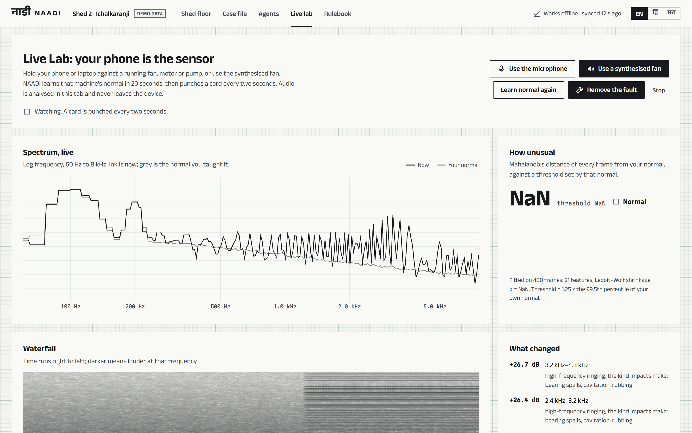

# 10 · The Live Lab

The Live Lab turns the device in your hand into a real sensor. It is the one part of NAADI where nothing is simulated: the features, the learned normal, the distance and the holes are all computed live from a real audio stream, in the browser, in [`src/lib/lab/engine.ts`](../src/lib/lab/engine.ts).

## Two sources

| Source | What it is | When to use it |
|---|---|---|
| **Microphone** | `getUserMedia` with echo cancellation, noise suppression and automatic gain **off**, so the machine's sound is not "cleaned up" | a phone or laptop held against a running fan, motor or pump |
| **Synthesised fan** | a looping 4 s buffer: 100 Hz hum, a 120 Hz blade-pass tone modulated at 24 Hz, pink noise; plus a second buffer of bearing impacts at 86 Hz, each ringing at 3.2 kHz, faded in by **Add a bearing fault** | a silent hall, a desktop without a microphone, a headless screenshot |
| **Motion** (phones) | `devicemotion` acceleration magnitude at about 60 Hz; RMS and the strongest frequency over the last 256 samples | an extra readout for low-frequency vibration (unbalance shows here) |

The audio is analysed in memory and never leaves the tab. Nothing is recorded or uploaded.

## Every frame (about 20 a second)

An `AnalyserNode` (FFT size 4,096, no smoothing) gives the magnitude spectrum in dB and the raw time samples. Each frame becomes a 21-number feature vector:

| # | Feature | Definition |
|---|---|---|
| 1–16 | band energies | mean power in 16 log-spaced bands from 60 Hz to 8 kHz, in dB |
| 17 | level | $20\log_{10}\text{RMS}$ of the time samples |
| 18 | crest | $\ln(\max\lvert x\rvert / \text{RMS})$ |
| 19 | kurtosis | $\ln\big(\mathbb{E}[(x-\mu)^4]/\sigma^4\big)$ |
| 20 | flatness | $10\log_{10}$ of the geometric over the arithmetic mean of the power spectrum |
| 21 | centroid | $\log_2$ of the power-weighted mean frequency |

## Learning normal (20 seconds, 400 frames)

1. **Standardise.** Each feature gets its mean $\mu_j$ and standard deviation $s_j$ (floored at 0.25 so a silent band cannot explode later); frames become $z = (x - \mu)/s$.
2. **Correlation.** $S = \tfrac1n \sum z z^\top$.
3. **Ledoit–Wolf shrinkage toward the identity.** With only 400 frames for 21 features, $S$ is noisy. The optimal shrinkage intensity is estimated from the data itself:

$$\hat\alpha = \min\left(1,\ \frac{\tfrac{1}{n^2}\sum_k \lVert z_k z_k^\top - S\rVert_F^2}{\lVert S - I\rVert_F^2}\right), \qquad \hat\Sigma = (1-\hat\alpha)\,S + \hat\alpha\,I$$

   A steady synthesised fan gives $\hat\alpha \approx 0.09$; a noisy room gives more.
4. **Invert** $\hat\Sigma$ by Cholesky decomposition.
5. **Threshold from your own normal.** Score every training frame, $D^2 = z^\top \hat\Sigma^{-1} z$, and set

$$\tau = \max\!\left(1.25 \times q_{0.995}\big(D^2_{\text{train}}\big),\ p + 3\sqrt{2p}\right)$$

   The second term is the χ² mean plus three standard deviations for $p = 21$, a floor for unusually quiet training data.

## Watching

Every frame after learning gets $D^2$ against $\tau$. The meter shows the live value; the history line shows the last 12 seconds on a log scale with $\tau$ in vermilion.

**A card every two seconds (40 frames)**, with the same grammar as the shed:

| Card row | Features in the group | A hole when |
|---|---|---|
| Level | level | the group's largest $\lvert z\rvert$ exceeds **3.5** in at least **30%** of the card's frames |
| Impulse | crest, kurtosis | 〃 |
| Low | bands 1–4 (60–200 Hz) | 〃 |
| Low-mid | bands 5–8 | 〃 |
| Mid | bands 9–12 | 〃 |
| High | bands 13–16 (up to 8 kHz) | 〃 |
| Tonality | flatness | 〃 |
| Brightness | centroid | 〃 |

The card's paint comes from the share of frames over $\tau$: **act** at 60% or more, **watch** at 25% or more, otherwise normal. Requiring 30% of a card's frames keeps a door slam from punching a hole.

## What changed

For each card, the mean band energies are compared with the learned normal; the three bands that rose most (by more than 3 dB) are listed with a plain-language reading:

| Where the energy rose | Reading |
|---|---|
| above about 1.8 kHz | high-frequency ringing, the kind impacts make: bearing spalls, cavitation, rubbing |
| below about 320 Hz | low-frequency rise: unbalance, looseness or a change of load |
| in between | blade pass, belt, gear mesh or electrical hum |

With the synthesised bearing fault, the Lab reports about **+26 dB at 2.4–4.3 kHz**, high-frequency ringing, which is exactly the housing resonance the impacts were synthesised to excite.

## Drawing without React in the loop

The engine draws the spectrum and the waterfall straight into two canvases every frame (the waterfall shifts itself left by two device pixels and paints one new column, paper to ink). React only renders the readouts, the history and the cards, through `useSyncExternalStore`, so the analysis keeps its frame rate however busy the page is.

## A one-minute demo

1. Open `/lab` on a phone (the overview page has a QR code) or a laptop.
2. **Use the microphone** and hold the device against a running table fan, or choose **Use a synthesised fan**.
3. **Learn normal · 20 s** while the fan runs as usual.
4. Touch the fan's guard, tape a coin to a blade, or press **Add a bearing fault**. Watch the distance cross the threshold, the cards punch holes, the waterfall change and *What changed* name the band.
