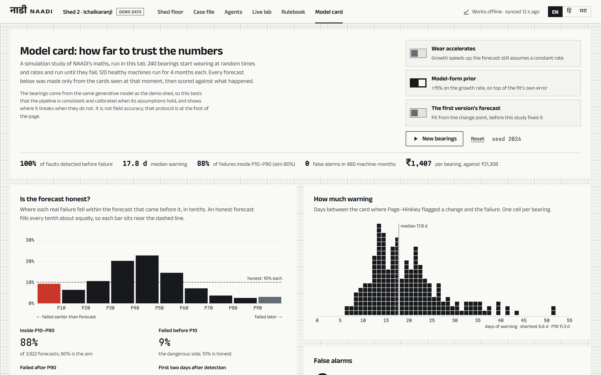
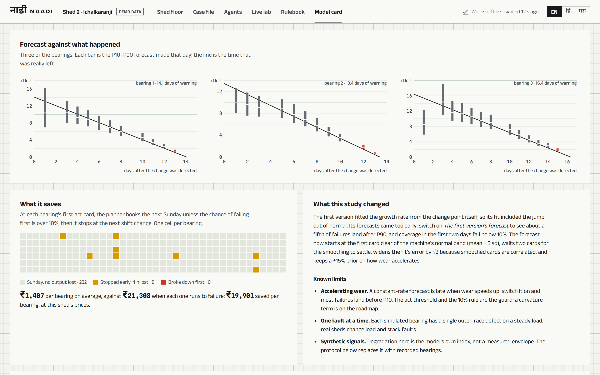

# 11 · Model card

`/model` answers one question: **how far should anyone trust NAADI's numbers?** It runs a simulation study of the whole pipeline in the browser, in [`src/lib/model/study.ts`](../src/lib/model/study.ts), and reports what it finds, including where the method breaks.

## What it is, and what it is not

The study draws bearings from the **same generative model as the demo shed**. That makes it a test of the maths, not of the world: it shows that change detection, the growth fit, the Monte Carlo and the repair policy are consistent and calibrated when their assumptions hold, and how badly they fail when an assumption is broken on purpose. Field accuracy needs recorded machines; that protocol is at the end of this page and is marked **pending** in the app.

## The study

| | |
|---|---|
| Faulty runs | 240 bearings. Healthy level $d_{\text{normal}} \sim U(0.012, 0.024)$; onset $t_0 \sim U(2, 8)$ days; starting size $d_0 \sim U(0.03, 0.06)$; growth $b \sim \text{LogNormal}(\ln 0.17, 0.35)$. Each runs, card by card, until $d = 1$. |
| Healthy runs | 120 machines for 4 months each (480 machine-months), no fault. |
| Cards | 6 h each, Sundays off, the same noise and smoothing as the shed ($d_S = 0.5\,d + 0.5\,d_S$). |
| What is scored | Page–Hinkley on $\ln d_S$; then, **once per day after detection**, the forecast made from the cards seen so far, scored against the true time left. |
| Policy | At the first act card, book the next Sunday unless P(failing first) > 10%; then stop at the next shift change, losing 4 h. |
| Seed | 2026 by default; **New bearings** draws another set. |

The page runs it in slices of about 28 ms so it never freezes; a full run takes under a second on a laptop.

## What it reports (seed 2026)

| Measure | Result | What good looks like |
|---|---|---|
| Faults detected before failure | **100%** | all of them |
| Warning, change detected → failure | median **17.8 days**, P10 11.3, shortest 6.6 | enough for a Sunday or a power cut |
| Failures inside the forecast's P10–P90 | **88%** of 3,922 forecasts | 80% |
| Failures before P10 (the dangerous side) | **9%** | 10% |
| Failures after P90 | **3%** | 10% |
| Inside P10–P90 in the first two days after detection | **61%** | 80%; the fit has the fewest cards here |
| False change points, healthy machines | **0** in 480 machine-months | as few as possible |
| Cost per bearing under the policy | **₹1,407**, against ₹21,308 run to failure | 232 Sunday repairs, 8 early stops, 0 breakdowns |

**Reading the calibration chart.** If the forecast is honest, the real failure lands in each tenth of the forecast distribution equally often, so every bar sits at 10%. Here the dangerous end (before P10) is at 9%, close to honest, while the middle bars are taller than 10% and the far end is short: the bands are a little wider than they need to be. That is a conservative error: it costs some early replacement, not breakdowns.

## What the study changed

The first version fitted the growth rate **from the change point itself**, with a ±25% model-form prior and the fit's error taken at face value. The study found two problems:

1. **The fit included the jump out of normal.** A bearing's index sits at its healthy level, then jumps when the spall forms, then grows. Fitting from the change point puts the jump into the slope, so early forecasts were far too pessimistic: about a fifth of failures came after P90, and in the first two days after detection only **7.6%** fell inside P10–P90.
2. **The fit's error was too small.** Smoothing makes neighbouring cards correlated, so the least-squares error overstates how much the cards know.

The forecast now:

- starts at the first scored card whose $\ln d_S$ clears the machine's normal band (mean + 3 sd of the cards before the onset), plus **two cards** for the smoothing to settle ([`fitStart`](../src/lib/model/shed.ts));
- scales the fit's error by $\sqrt{(1+\rho)/(1-\rho)} = \sqrt 3$ for the smoothing's lag-one correlation $\rho \approx 0.5$;
- keeps a model-form prior of **±15%** on how wear accelerates.

| | First version | Now |
|---|---|---|
| Inside P10–P90, all forecasts | 75% | **88%** |
| Inside P10–P90, first two days | 7.6% | **61%** |
| Failures after P90 | 21% | **3%** |
| Failures before P10 | 4.5% | **9%** |
| Early stops (4 h lost) under the policy | 35 | **8** |
| Cost per bearing | ₹1,834 | **₹1,407** |

The switch **The first version's forecast** on the page reruns the study with the old method, so the comparison is live, not quoted.

For the demo, the change moved Loom 03's forecast from P50 7.3 to **6.6 days** and its growth rate from 0.216 to **0.209 per day**, against a synthetic truth of 0.21 and a failure 6.3 days after card 56.

## Where it breaks

| Switch | Result | What it means |
|---|---|---|
| **Wear accelerates** ($d = d_0 e^{b\tau + a\tau^2}$, $a \sim U(0.006, 0.018)$) | coverage falls to about 10%; about 90% of failures come before P10; 55 of 240 bearings break down under the policy | a constant-rate forecast is late when wear speeds up. The act threshold and the 10% rule catch most, not all. A curvature term (and testing it for significance before trusting it) is on the [roadmap](08-roadmap.md). |
| **Model-form prior** off | coverage 63%; 31% before P10 | the fit's own error is not enough; the prior is doing real work |

## On public data: the protocol, not yet run

| Dataset | What it holds | What NAADI would report |
|---|---|---|
| **NASA IMS** bearings | run-to-failure vibration of four bearings on one shaft, 1-second snapshots every 10 minutes | warning time from the change point; P10–P90 coverage of time to failure, as above |
| **CWRU** bearing data | seeded inner-race, outer-race and ball faults at four loads, 12 and 48 kHz | the envelope peak at the right defect tone; confusion between the BPFO and BPFI rules |
| **MIMII** | normal and anomalous sound of fans, pumps, slide rails and valves, with factory noise | area under the ROC curve of the Live Lab's Mahalanobis score, per machine |

None of these has been run in this build, and the app claims no numbers for them.

## Checks

`npm run test:model` runs a smaller version of the study (160 bearings, 80 healthy machines) and fails if coverage leaves 75–95%, if failures before P10 exceed 15%, if any fault goes undetected, if false alarms exceed 0.05 per machine-month, or if the policy costs more than a fifth of running to failure. It also prints the accelerating-wear result as a known limit.
