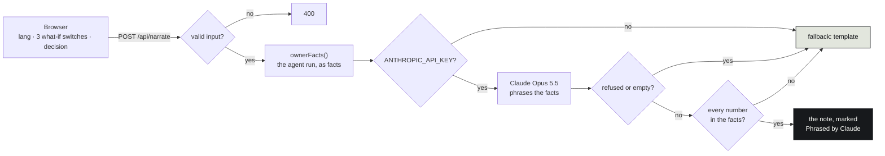

# 12 · The narrator

The owner's note in the agent console can be phrased by **Claude**, in English, Hindi or Marathi. It is the one place NAADI uses a language model, and it is fenced on every side: the model sees only facts the server computed, it may not change a number, and a checker refuses any phrasing that tries. Without an API key the app writes the same note from a template, so the demo never depends on the network.



## What goes in

The browser sends four things and nothing else: the language, the two scenario switches (power cut, part in stock), whether the weaver's note counts, and the owner's decision. [`parseNarrateInput`](../src/lib/agents/facts.ts) rejects anything else with a 400, so no free text from the page can reach the model.

The server then builds the facts with [`ownerFacts`](../src/lib/agents/facts.ts) from the same agent run the console streams:

| Fact | Example (base scenario) |
|---|---|
| machine | Loom 03, motor drive-end bearing 6205-2RS |
| likelyCause, probability, rule | bearing outer-race defect, 88.6%, BRG-OR-01 |
| evidence | the envelope peak, kurtosis, the weaver's note, housing temperature, as worded in the case file |
| timeToFailure | P10 5.4 days, P50 6.6 days, P90 8.1 days |
| recommendedWindow, windowNote | Thu 19 Nov, 14:00–18:00, scheduled power cut |
| chanceOfFailingFirst, expectedCost, breakdownBill | <0.1%, ₹1,280, ₹21,308 |
| part, drafts, ownerDecision | in stock at Laxmi Bearing House, ₹380; a WhatsApp and a technician hold; waiting for the owner |

The same facts are shown under the note (**The facts the note is written from**), so anyone can compare the wording with what it was given.

## The call

[`src/app/api/narrate/route.ts`](../src/app/api/narrate/route.ts) uses the official TypeScript SDK, `@anthropic-ai/sdk`:

| Setting | Value | Why |
|---|---|---|
| model | `claude-opus-5-5` | the current default model |
| `output_config.effort` | `low` | a three-sentence note does not need deep thinking; low effort keeps it quick |
| thinking | left out | thinking stays adaptive on this model |
| `fallbacks` | `'default'`, with beta `server-side-fallback-2026-07-01` | if the model declines, the API reruns the request on its default fallback model in the same call |
| `max_tokens` | 16,000 | a ceiling, not a target |
| client | 25 s timeout, one retry; route `maxDuration` 30 s | the owner is waiting on a button |

The system prompt tells the model to write two or three plain sentences from the facts, to copy every number exactly as given (same digits, the ₹ sign, digits 0–9 even in Devanagari script), never to round or compute, to cite the rule ID once, and to add no greeting, list or markdown.

## The number check

[`checkNumbers`](../src/lib/agents/facts.ts) reads every number out of the reply (Devanagari digits are read as 0–9 and thousands separators dropped) and accepts the reply only if each one also appears in the facts. A reply that says "₹1,300" or "7 days" when the facts say ₹1,280 and 6.6 days is refused, and the owner sees the template with the reason: *its draft used a number that is not in the facts*.

It is a blunt rule on purpose. NAADI's promise is that numbers come from deterministic tools; the check turns that promise into code.

## Costs and limits

- There are only 72 possible inputs (3 languages × 2 × 2 × 2 × 3 decisions), and each server instance caches a phrasing it has accepted, so a public deployment pays for at most 72 calls per instance.
- `GET /api/narrate` reports `{ enabled, model }`; the console only offers **Phrase with Claude** when it is enabled.
- Failures never reach the owner as errors: a refusal, an empty reply, a rejected key, a rate limit or a network failure all fall back to the template, with the reason in one line.
- The phrasing in Hindi and Marathi, like the template's, needs a native speaker's review before it reaches owners.

## Turning it on

```bash
# .env.local (never committed), or the project's environment variables on Vercel
ANTHROPIC_API_KEY=sk-ant-...
```

Restart `npm run dev`, open `/agents`, and press **Phrase with Claude** under *For the owner*. The note says which wrote it: **Phrased by Claude from the facts · all 6 numbers checked against them**, or **Template**.

This build was verified with the key absent (the route reports itself disabled, the console shows the template, a malformed request gets a 400) and with the checker on hand-written replies. A live call was not made while building it.
