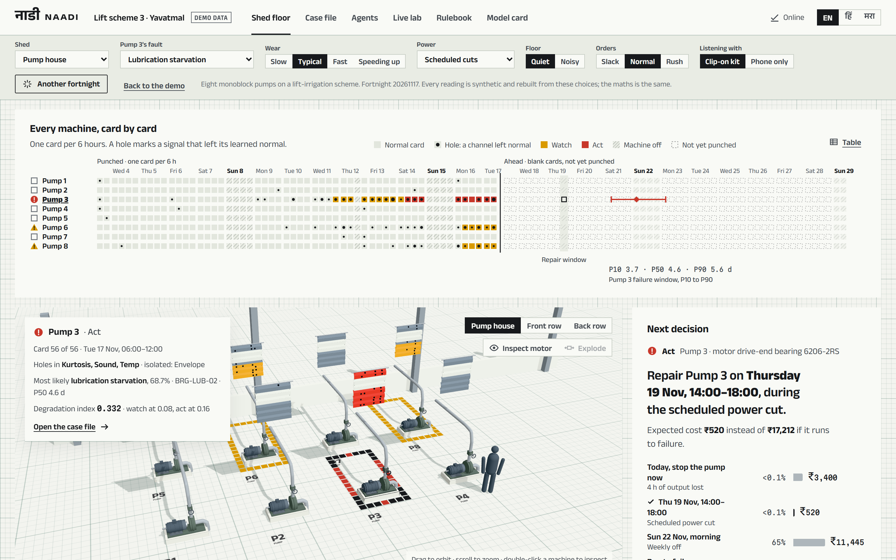

# 13 · Setups: the same maths, a different fortnight

The setup bar under the header changes the shed before any page is built. You can pick the kind of shed, what fault its hero machine develops, how fast it wears, how the power behaves and how noisy the floor is, or draw another random fortnight. Every page is rebuilt from that choice: the floor, the case file, the agents, the landing story, the rulebook evidence and the rupees. The demo is no longer one recorded story. It is a generator, and the detector, forecast and Bayes are read from whatever it produces.

**Everything here is synthetic.** A setup changes the data. It never changes the maths.

## The choices

| Choice | Options | What it changes |
|---|---|---|
| **Shed** | powerloom shed, flour mill, pump house | the machines and floor plan, the hero machine NAADI follows, its motor speed and drive-end bearing, the hourly cost of downtime, who leaves the voice note, and the 3D camera views (see below) |
| **Loom 03's fault** | bearing outer race, bearing inner race, unbalance, misalignment, lubrication starvation, looseness | which channels leave normal and in what order, the envelope spectrum's signature, the evidence, the leading cause, the part, its price and labour, the action and the drafts |
| **Wear** | slow, typical, fast, speeding up | the growth rate *b* of the degradation index; *speeding up* adds a curvature term *a* in ln d, so the forecast's curvature term has something to find |
| **Power** | scheduled cuts, reliable, unscheduled cuts | whether Thursday's 14:00 cut exists as free repair time; *unscheduled* blanks roughly 7% of cards at random (seeded), which the scorer skips |
| **Floor** | quiet, noisy | the false-hole rate (0.6% → 2%) and the noise on every channel's score |
| **Orders** | slack, normal, rush | the margin an hour of downtime loses: half when output can be made up later, 1.8× when a delivery is due (a late-delivery penalty); idle wages and the planned bill do not change |
| **Listening with** | clip-on kit, phone only | which channels exist and how loud the bearing sounds (see below) |
| **Another fortnight** | a new random seed | the onset card (3.5–6.5 days in), the growth rate (±15%) and each channel's centre card jitter, so two fortnights of the same fault differ |

**Back to the demo** restores the default: the powerloom shed, outer-race defect, typical wear, scheduled cuts, quiet floor, normal orders, the clip-on kit, seed 20261117. With the default setup, every number in the README and the demo script is reproduced exactly (88.6%, P50 6.6 days, Thursday at ₹1,280).

## The sheds

| Shed | Place (synthetic) | Machines | Hero | Motor | Drive-end bearing | Margin + wages per hour | Voice note |
|---|---|---|---|---|---|---|---|
| Powerloom shed | Shed 2 · Ichalkaranji | 6 looms, a chakki, 2 pumps | Loom 03 | 2 hp, 4-pole, 1,436 rpm | 6205-2RS, 9 balls, ₹380 | ₹700 + ₹250 | Sunita K., weaver |
| Flour mill | Girni 1 · Amravati | 6 chakkis, a water pump | Chakki 3 | 7.5 hp, 4-pole, 1,452 rpm | 6308-2RS, 8 balls, ₹720 | ₹450 + ₹180 | Ramesh P., miller |
| Pump house | Lift scheme 3 · Yavatmal | 8 monoblock pumps | Pump 3 | 5 hp, 2-pole, 2,904 rpm | 6206-2RS, 9 balls, ₹450 | ₹600 + ₹120 | Vitthal D., pump operator |

The bearing's geometry sets the defect frequencies, so the same fault lands somewhere else on each shed's spectrum: BPFO is 85.8 Hz on the loom, 74.3 Hz on the chakki and 172.6 Hz on the pump. The case file, the bearing section, the inspect view in 3D, the fault wording ("eight balls cross a spall… 3.072 times a turn"), the part, its price and the dealer's message all follow. Each other shed draws its own fortnight from the same seed, so the timeline differs too (P50 6.6, 8.5 and 4.6 days at the default seed). The other machines that need watching differ by shed: a slipping belt and a cavitating pump in the loom shed and the mill; a cavitating pump and a cracked rotor bar in the pump house.

Every machine of every shed has a case-file page. If you change the shed while a case file is open, it moves to the new shed's hero. A link to a machine that isn't in the active shed says so and points to the hero.

## Money and the sensor kit

**Orders** change what a breakdown costs, not when it happens. For the default fault the breakdown bill is ₹15,708 with slack orders, ₹21,308 normally and ₹30,268 in a rush. The case file says which applies in its cost table.

**Listening with a phone only** models what a phone propped against the machine can and cannot do:

- It has a microphone and an accelerometer, but no current clamp and no thermistor. The current and temperature channels are never punched; they stay grey in the channel chain and the landing's record, and their tooltip says *No sensor*.
- It hears the bearing through the air, not through the housing, so bearing tones in the envelope stand half as high (in dB) and the grease hiss is weaker. Its accelerometer sees the 1× and 2× shaft tones as well as the kit does.
- Its degradation index comes from fewer, weaker channels, so it is noisier, including on the wear itself.

What that gives, measured:

| Fault | Clip-on kit | Phone only |
|---|---|---|
| outer race | 88.6% | 92.1% |
| inner race | 78.2% | 82.3% |
| unbalance | 50.4% | 50.4% |
| misalignment | 57.1% | 58.9% |
| lubrication | 74.3% | **60.0%** |
| looseness | 73.5% | 72.2% |

In this model a phone catches the change at the same card (24) and forecasts with a slightly wider band (P10–P90 5.2–8.0 days against 5.4–8.1 at the default). What it loses is telling causes apart where heat or current is the clue: starved grease runs hot, so without a thermistor its lead falls from 74.3% to 60.0%. The bearing races rise a little with a phone for the same reason in reverse: the temperature term was nudging the ranking towards lubrication, and a phone does not have it. With the kit, the case file sets the saving from repairing in the best window against the kit's ₹1,500 (13.4 times its price at the default).

This is a model of a phone, not a measurement of one. The Live Lab is where a real phone is used.

## Each fault's fingerprint

Each fault has a channel order (the logistic that raises each channel's hole probability over the fortnight) and a spectral family that the envelope spectrum is drawn from.

| Fault | Rule | Channels, in the order they leave normal | Spectrum | Part | ₹ part + labour |
|---|---|---|---|---|---|
| Bearing outer race | BRG-OR-01 | envelope, kurtosis, sound, velocity, temperature | BPFO and its harmonics | 6205-2RS bearing | 380 + 900 |
| Bearing inner race | BRG-IR-01 | envelope, kurtosis, sound, velocity, temperature | BPFI with 1× sidebands | 6205-2RS bearing | 380 + 900 |
| Unbalance | UNB-01 | 1×, velocity, sound, current | 1× shaft, little at the bearing tones | balance weights | 150 + 700 |
| Misalignment | ALN-02 | 2×, 1×, velocity, temperature | 2× beside 1× | shims, V-belt | 420 + 800 |
| Lubrication starvation | BRG-LUB-02 | temperature, sound, kurtosis, envelope | a broadband high-frequency rise, no tone | grease | 120 + 400 |
| Looseness | LSN-01 | 1×, 2×, kurtosis, velocity, sound | a ladder of shaft harmonics | bolts, mount pad | 260 + 600 |

## How the evidence follows

The replay reads the spectrum as of each card and turns what it sees into evidence, each with a likelihood ratio per hypothesis ([`decide.ts`](../src/lib/model/decide.ts)). The terms added for setups:

| Evidence | Seen when | Strongest for |
|---|---|---|
| `bpfiPk` | a peak at BPFI with sidebands one shaft speed either side | inner race (×9) |
| `x1up` | 1× well above its first week | unbalance (×8) |
| `x2up` | 2× risen against its first week | misalignment (×7) |
| `hf` | the high band rises with no tone standing out | lubrication (×7) |
| `harm` | four or more shaft harmonics out of the floor | looseness (×8) |
| `quiet` | no envelope peak at either bearing tone | argues against both bearing races (×0.15, ×0.2) |

The `quiet` term matters. Without it, unbalance and misalignment were ranked too weakly against the bearing faults, because the absence of a bearing tone was never counted as evidence.

## What each setup gives (measured, `npm run test:model`)

| Setup | Leading cause | Plan |
|---|---|---|
| default (outer race) | BRG-OR-01 · 88.6% | Thursday's cut · ₹1,280 |
| inner race | BRG-IR-01 · 78.2% | Thursday · ₹1,280 |
| unbalance | UNB-01 · 50.4% | Thursday · ₹850 |
| misalignment | ALN-02 · 57.1% | Thursday · ₹1,220 |
| lubrication | BRG-LUB-02 · 74.3% | Thursday · ₹520 |
| looseness | LSN-01 · 73.5% | Thursday · ₹860 |
| slow wear | Watch · P50 12.7 d | Thursday · ₹1,280 |
| fast wear | Act · P50 2.8 d | Thursday · ₹1,891 |
| speeding up | Act · P50 1.8 d | stop now · ₹5,080 |
| reliable power | Act · P50 6.6 d | Sunday · ₹1,871 |
| unscheduled cuts | Act · P50 6.9 d | Sunday · ₹1,651 |

Unbalance and misalignment lead with lower confidence than the bearing faults. That is honest: with only 1× and 2× to go on, the rulebook leaves real weight on the neighbouring causes, and the case file shows the runner-up.

## Shareable links

A setup lives in the address bar, so a link reproduces it on any device: `/machine/L03?fault=unb&wear=fast` opens the unbalance case with fast wear, and `/floor?shed=pumphouse&fault=lub` opens the pump house with starved grease. Only the choices that differ from the default are written. The setup is also kept on the device with the owner's decision; a link with setup parameters wins over what was saved. Changing the setup clears the decision, the replay position and the selected machine, because they belonged to another fortnight.

## How it is built

- [`sheds.ts`](../src/lib/model/sheds.ts): the three sheds, each with its machines, hero, bearing, speed, costs, voice note, camera views and fault wording.
- [`setup.ts`](../src/lib/model/setup.ts): the choices, the six faults (channel logistics, family, part, price, action, where, why), the active setup and the query codec.
- [`shed.ts`](../src/lib/model/shed.ts): `buildShed(setup)` draws Loom 03 from the fault's channels, the wear's *b* and *a*, the floor's noise and the seed's jitter; power decides which cards are off.
- [`physics.ts`](../src/lib/model/physics.ts): `envelopeSpectrum(seed, severity, family)` draws each family's signature; `readSpectrum` measures what the evidence rules need.
- [`replay.ts`](../src/lib/model/replay.ts), [`index.ts`](../src/lib/model/index.ts): caches keyed by the setup, so switching back is instant.
- [`Setup.tsx`](../src/components/shell/Setup.tsx): the bar, and `SetupScope`, which sets the active setup before render and remounts the page when it changes.
- Checks: `scripts/check-model.ts` asserts that every fault is diagnosed as itself, with a forecast and a feasible window, under every wear, power, floor and seed tried, and in every shed, where it also checks that the hero is the machine that degrades and that its speed is recovered from its own spectrum. `scripts/check-setups.mjs` drives a real browser through a shared link, a switch, the floor, back to the demo, a pump-house link and a switch to the mill from an open case file.

## A healthy fortnight

*Nothing: a healthy fortnight* is the last option under the fault. The hero wears nothing out, and NAADI should say nothing about it. That is the control every other setup needs: a monitor that cries wolf gets switched off.

- The hero punches only isolated holes (2 or 3 in 56 cards in each shed, about what the false-hole rate predicts) and Page–Hinkley never fires, so there is no forecast, no ranking of causes and no bill.
- The landing tells that story instead: *Your loom is fine, and NAADI says so*, then *Fourteen days, nothing to catch* and *Saying nothing is a result*, with the machines that are still being watched.
- The floor's decision panel says *Nothing to repair. Keep running.* The hero's case file is its plain record. The agents page shows the one call made: the Sentinel scores card 56, and nothing is handed on.
- The other machines keep their own faults, so the watch list still has work in it.

`npm run test:model` checks the healthy fortnight in every shed: no alarm, no forecast, no evidence, and the hero at normal.

## Sounds and drawings for every fault

*Hear it* in the case file synthesises the active fault, not only the outer race:

| Fault | Now sounds like | Drawing |
|---|---|---|
| outer race | an impact at every ball pass (BPFO), ringing the housing near 3.2 kHz | the bearing in section, spall fixed in the load zone |
| inner race | impacts at BPFI, loud in the load zone and quiet away from it | the spall on the inner race, turning with the shaft; the balls cross it from the other side |
| unbalance | a deeper rumble at 1× | the rotor end on: a heavy spot pulls its centre round a small orbit once a turn |
| misalignment | 2× beating against 1× | the coupling side on: shafts meeting at an angle, the gap opening and closing twice a turn |
| lubrication | a dry hiss above 2 kHz, no single tone | the bearing with no spall; the dashed bands where balls rub on dry races |
| looseness | a knock once a turn and a softer one every other turn, ringing low | the motor end on: a foot lifting off a loose bolt and knocking back |

The frequency table under the drawing marks the tone that fault raises (BPFO, BPFI, 1× or 2×). The drawings run 40 times slower than life, with the signal the fault makes on the strip below. They are synthesised from the model; real recordings replace them in the field build.

## The model card, for the chosen setup

With a setup chosen in the bar, `/model` runs its study under that setup's conditions by default. That means the wear rate's median growth, the floor's and the kit's noise, accelerating wear when *Speeding up* is chosen, and the rupees: the shed's margin scaled by the orders, plus the fault's part and labour. The switch *Run it for the setup above* turns it back to the generic study the docs quote. A few results (seed 2026, 240 bearings, 120 healthy machines over 4 months):

| Setup | Median warning | P10–P90 coverage | Failures before P10 | False alarms a machine-month | Saving per bearing |
|---|---|---|---|---|---|
| generic study | 17.8 d | 88% | 9% | 0 | ₹19,901 |
| default setup | 14.1 d | 84% | 12% | 0 | ₹19,616 |
| fast wear | 10.8 d | 80% | 17% | 0 | ₹18,983 |
| speeding up | 10.1 d | 34% | 66% | 0 | ₹16,641 |
| noisy floor, phone only | 14.1 d | 76% | 13% | 0.45 | ₹19,490 |
| pump house, rush orders | 14.1 d | 84% | 12% | 0 | ₹23,550 |

The noisy floor heard through a phone is the first setup where healthy machines raise false alarms: about one every two machine-months. That is the honest cost of listening with less.

## Not yet

- A **Live Lab** session is not tied to a setup.
- A **machine shop** (lathes, a drill press, a compressor) needs its own 3D models first.
- A phone's sensitivity here is assumed (half the bearing tones' dB, 1.5× the noise); it should be fitted from Live Lab recordings against a clip-on accelerometer.
- Hindi and Marathi wording for the shed and fault sentences; only the decision line follows the shed today.
